<!-- cairn-nav:start -->
<p align="center"><b>Cairn is a family of six repositories.</b> Each builds, tests and releases on its own; they agree through the shared <a href="https://github.com/ParkWardRR/cairn-driving-log-selfhosted/tree/main/contracts">contracts</a>, and they share one <a href="https://github.com/ParkWardRR/cairn-driving-log-selfhosted/blob/main/ROADMAP.md">roadmap</a>.</p>

| Part | Repository | What it does | Stack | Docs | Issues | CI |
|---|---|---|---|---|---|---|
| Front door | [cairn-driving-log-selfhosted](https://github.com/ParkWardRR/cairn-driving-log-selfhosted) | Docs, roadmap, shared protocol contracts | Markdown · Go tools | [docs](https://github.com/ParkWardRR/cairn-driving-log-selfhosted/tree/main/docs) | [issues](https://github.com/ParkWardRR/cairn-driving-log-selfhosted/issues) | [CI](https://github.com/ParkWardRR/cairn-driving-log-selfhosted/actions) |
| Dongle | **[cairn-esp32-device-firmware](https://github.com/ParkWardRR/cairn-esp32-device-firmware)** ◀ you are here | In-car recorder: OBD-II, GNSS, IMU to encrypted SD bundles | C++ · C · Rust | [docs](https://github.com/ParkWardRR/cairn-esp32-device-firmware/tree/main/docs) | [issues](https://github.com/ParkWardRR/cairn-esp32-device-firmware/issues) | [CI](https://github.com/ParkWardRR/cairn-esp32-device-firmware/actions) |
| Phone | [cairn-ios-companion-app](https://github.com/ParkWardRR/cairn-ios-companion-app) | BLE relay, GPS assist, server client | Swift · SwiftUI | [docs](https://github.com/ParkWardRR/cairn-ios-companion-app/tree/main/docs) | [issues](https://github.com/ParkWardRR/cairn-ios-companion-app/issues) | [CI](https://github.com/ParkWardRR/cairn-ios-companion-app/actions) |
| Server | [cairn-vehicle-server](https://github.com/ParkWardRR/cairn-vehicle-server) | Verifies, decrypts, stores; serves app and dashboard | Go | [docs](https://github.com/ParkWardRR/cairn-vehicle-server/tree/main/docs) | [issues](https://github.com/ParkWardRR/cairn-vehicle-server/issues) | [CI](https://github.com/ParkWardRR/cairn-vehicle-server/actions) |
| Dashboard | [cairn-vehicle-web-dashboard](https://github.com/ParkWardRR/cairn-vehicle-web-dashboard) | Browser UI: trips, places, engine, health | Nuxt · TypeScript | [docs](https://github.com/ParkWardRR/cairn-vehicle-web-dashboard/tree/main/docs) | [issues](https://github.com/ParkWardRR/cairn-vehicle-web-dashboard/issues) | [CI](https://github.com/ParkWardRR/cairn-vehicle-web-dashboard/actions) |
| Modules | [cairn-modules](https://github.com/ParkWardRR/cairn-modules) | Interpretation, separated from the logging core: one package per module | YAML · Rust | [readme](https://github.com/ParkWardRR/cairn-modules#readme) | [issues](https://github.com/ParkWardRR/cairn-modules/issues) | [CI](https://github.com/ParkWardRR/cairn-modules/actions) |

<sub>Shared: [Roadmap](https://github.com/ParkWardRR/cairn-driving-log-selfhosted/blob/main/ROADMAP.md) · [Install](https://github.com/ParkWardRR/cairn-driving-log-selfhosted/blob/main/INSTALL.md) · [Architecture](https://github.com/ParkWardRR/cairn-driving-log-selfhosted/blob/main/docs/architecture.md) · [Threat model](https://github.com/ParkWardRR/cairn-driving-log-selfhosted/blob/main/docs/threat-model.md) · [Trust model](https://github.com/ParkWardRR/cairn-driving-log-selfhosted/blob/main/docs/trust-model-v3.md) · [Contracts](https://github.com/ParkWardRR/cairn-driving-log-selfhosted/tree/main/contracts) · [Archive of the original monorepo](https://github.com/ParkWardRR/cairn-original-monorepo-archive)</sub>
<!-- cairn-nav:end -->
<h1 align="center">Cairn ESP32 device firmware</h1>
<p align="center"><strong>The firmware for the Cairn in-car dongle. It records your drives to an SD card as encrypted, tamper-evident bundles, and hands them to your own server — over Bluetooth through your phone, or by itself over cellular. It never deletes a trip until your server has signed for exactly that trip.</strong></p>

<p align="center">
  <a href="https://github.com/ParkWardRR/cairn-esp32-device-firmware/actions/workflows/ci.yml"></a>
  <a href="https://github.com/ParkWardRR/cairn-esp32-device-firmware/actions/workflows/interop.yml"></a>
  <a href="LICENSE"></a>
  
  
  
</p>

---

This repository is one of six that make up [Cairn](https://github.com/ParkWardRR/cairn-driving-log-selfhosted), a self-hosted car driving log. This one is the dongle — the part in the car. The system:

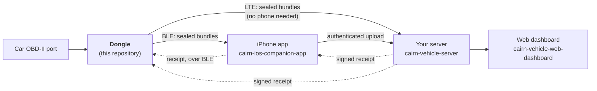

Whichever path a bundle takes, the rule is the same: the carrier moves ciphertext it cannot read, and the dongle frees the card only on a receipt it has verified itself.

**Contents:**
[What it is](#what-the-dongle-is-and-is-not) ·
[Status](#status) ·
[Hardware](#hardware) ·
[Architecture](#architecture) ·
[Capture to bundle](#from-capture-to-a-sealed-bundle) ·
[BLE and offload](#ble-service-and-bundle-offload) ·
[Enrolment](#enrolment-and-provisioning) ·
[secrets.h](#secretsh) ·
[OTA and partitions](#ota-and-the-ab-partitions) ·
[Security](#security-posture) ·
[Engine profiles](#engine-profiles) ·
[Device info and boot timing](#device-info-and-boot-timing) ·
[Cores not yet wired](#host-tested-cores-that-are-not-wired-in-yet) ·
[Tests](#tests) ·
[Layout](#repository-layout) ·
[Build and flash](#build-flash-and-test) ·
[Configuration](#configuration) ·
[Troubleshooting](#troubleshooting) ·
[FAQ](#faq) ·
[Docs index](#docs-index) ·
[Contributing](#contributing) ·
[License](#license)

> **Where this is going** is not in this README. The project keeps **one** roadmap, for all six
> repositories: [ROADMAP.md](https://github.com/ParkWardRR/cairn-driving-log-selfhosted/blob/main/ROADMAP.md).
> This repository's next work is [Phase 27](https://github.com/ParkWardRR/cairn-driving-log-selfhosted/blob/main/ROADMAP.md#phase-27--a-trip-you-can-trust--in-progress)
> (a trip you can trust — one drive away) and [Phase 28](https://github.com/ParkWardRR/cairn-driving-log-selfhosted/blob/main/ROADMAP.md#phase-28--the-networked-dongle-finished--in-progress)
> (the networked dongle, finished).

## What the dongle is, and is not

**Is.** A Freematics ONE+ Model B (ESP32) plugged into the car's OBD-II port. While you drive it samples the engine computer (OBD-II PIDs), GNSS position and an accelerometer/gyro, decides when a trip starts and ends, and writes everything to a microSD card in a format designed to survive power loss and tampering. When you park, it seals the trip into a signed bundle and waits for your phone to collect it.

**Is not.**

- **A network device since 2026-10-07.** Bundles leave over BLE to the enrolled phone, and also by the dongle's own cellular link: `env:cairn` runs the uplink schedule and uploads sealed bundles to the ingest server over mTLS, pruning each one on a receipt verified against a key pinned in firmware. Wi-Fi has been on in production since 2026-10-14 (`2e06252`): the BLE controller is stopped for the length of a Wi-Fi slot, because it could not associate while the controller was up ([#31](https://github.com/ParkWardRR/cairn-esp32-device-firmware/issues/31)). This firmware therefore **does** hold network credentials — Wi-Fi SSID and passphrase, a pinned CA, this device's mTLS client certificate and key, the APN — compiled into the gitignored `include/secrets.h` and so present in plaintext flash. The original condition (encrypt the storage first) cannot be met on this unit, since it needs eFuse burns ruled out on the only dongle; what a flash dump costs an attacker is stated exactly in [Security posture](#security-posture). See [docs/network-uplink-status.md](docs/network-uplink-status.md) for what has actually run on hardware.
- **Not trusted to delete on anyone's say-so.** Not even the phone's. A bundle is deleted only when a receipt signed by your server, verified on the dongle against a key pinned in the firmware, names that exact bundle.
- **Not a place where the card is the security boundary.** Every record on the SD card is encrypted. Pulling the card reveals ciphertext.
- **Not chatty on the car's network.** While the car is parked the dongle sends no diagnostic requests at all (the "parked-silence" rule, [below](#power-and-parked-silence)).
- **Not a bootloader-secured device.** This unit's chip cannot do ESP32 Secure Boot V2; see [Security posture](#security-posture).

The phone sees only ciphertext and is trusted for availability, not for secrecy or deletion; the server holds the keys to read the data.

## Status

As of **2026-10-24**, separating what is **proven** on the one real dongle (ESP32 revision v1.0) from what is **built** and from what is only **designed**. A fix that has landed and has not been seen on a drive counts as built, not proven.

**On the unit: a `beta` build of `6e62b44`, flashed over USB on 2026-10-23** (NVS backed up first; not tagged). It carries the GNSS vetting and per-bundle dating of PR #53 and the link lock and rebuilt trip detection of PR #54, none of which has been seen on a drive yet. The last `stable` release is still **`v0.1.3`, commit `6d42713`, flashed 2026-10-10** — three patch releases that evening: v0.1.1 the bond self-heal, v0.1.2 the last unsatisfiable `WRITE_AUTHEN`, v0.1.3 a failed pairing that describes itself. (`CAIRN_FIRMWARE_VERSION` stays `cairn-v0.1.0` because it is sealed into a 32-byte field and must not grow; the tag and the commit are what distinguish a release.) See [Releases](#releases). The [roadmap](https://github.com/ParkWardRR/cairn-driving-log-selfhosted/blob/main/ROADMAP.md#open-defects) tracks what closes each open item.

**Field state, 2026-10-23: no transport delivered from the car.** Wi-Fi to the home network failed at the router (`AUTH_FAIL`, then `HANDSHAKE_TIMEOUT`, although the compiled credentials match the network's); LTE registration was **denied**, a SIM or plan matter rather than firmware; and BLE from a Mac was too weak to hold a transfer. The card's bundles were recovered by reading the SD card on a Mac and uploading them with the server's `cmd/cairn-push`. Nothing on the card was lost, which is the receipt rule doing its job.

| Area | State |
|---|---|
| **Trip dates, per bundle** | **Fixed in `2d262f9` and `f940c84`, not yet seen on a drive.** The 2026-10-14 drive put **12 of its 37 bundles** back in 1970: `seal_and_reopen` cleared the UTC basis, and GNSS repeats its time observation only every 2 minutes, so a bundle sealed before the next one was signed with basis 0. The basis is UTC at monotonic zero and a seal does not change the boot's clock, so it is now carried into the next capture within a boot. Two neighbours fixed with it: frames are stamped with the fact's own sample time rather than the time they were written (facts queued during a ~2.5 s seal all shared one time, up to eight fixes at once), and a capture left open by an **earlier** boot is now sealed at boot instead of extended — one bundle had mixed two boots' monotonic clocks under the old `boot_id`, which dated 7 h of parked records a day late |
| **Trip dates, across reboots** | **Fixed and PROVEN on the 2026-10-09 drive** ([#38](https://github.com/ParkWardRR/cairn-esp32-device-firmware/issues/38), closed). Both bundles from that drive carry real 2026 timestamps and `reproduced: true`, where all fifteen earlier trips decoded to 1970-01-01; `time_obs` held 8 GNSS observations with none marked `adopted`, so the basis was already established when they were recorded — the sidecar doing its job rather than a fresh fix being taken. One gap closed late and worth keeping: the deployed server was still `b801582`, whose manifest decoder rejects unknown keys, so had the drive happened before that deploy the bundles would have been **refused at ingest**. The original defect, for the record: Every trip on the server was dated 1970, from two defects in one path. The UTC basis lived only in RAM, and the dongle is bus-powered — switching the car off cuts power mid-capture, so a bundle is almost always sealed on a *later* boot after a resume, and a resume had nowhere to restore a basis from. It was also anchored at the wrong instant: readers reconstruct a wall clock as `utc_basis_ms + frame.monotonic_ms`, and this firmware writes device uptime into `monotonic_ms`, so the basis has to be UTC at monotonic **zero**, not UTC at the sample. Now a CRC'd `utcbasis.bin` sidecar beside the capture, and the subtraction lives in one place. One new storage-matrix row (41 → 42). Confirming it needs a drive with a GNSS fix ([#38](https://github.com/ParkWardRR/cairn-esp32-device-firmware/issues/38)) |
| **Time from every source** | **Wired in.** GNSS (now repeated every 2 minutes rather than once), the cellular network (`AT+CCLK?` during link-up) and the phone (BLE `UTC_SYNC`) each emit a `TIME_OBSERVATION` record; the manifest basis stays first-wins and the records are the evidence trail. One plausibility floor for all three, applied where an observation becomes the basis rather than per source — because every clock here can lie in a way that parses: the SIM7600 answers with its 1980 build default before NITZ, and a GNSS receiver with no fix yields a flawless 2000-01-01. **No client writes `UTC_SYNC` yet**, so the phone source is wired and unexercised |
| **Trip detection and the co-processor link** | **Rebuilt in `6e62b44` after the dongle lost almost every drive between 2026-10-15 and 2026-10-23; not yet proven on a drive.** One 22.8 h boot's journal shows the rail at 14.7–16.0 V (alternator charging) in five separate hours, yet the state machine considered a trip twice and confirmed one, for 8 s; OBD answered for 11 s all day. Three faults compounded. (1) The co-processor link (GNSS, OBD, supply voltage) was used by two tasks with no lock: the controller's `getVoltage()` exchanges every 500 ms interleaved with the sensing task's GNSS and OBD traffic, and while driving about half the rail readings came back 9000 mV, 16000 mV or unreadable. (2) So the 15 s engine-on dwell never completed, the bus never opened and OBD was never polled; with OBD silent and a smooth road the start score sat at 1.00 (GNSS alone) under the 1.50 threshold. (3) Any smooth stretch (< 120 mg) sent an active trip to `TRAILING` and two minutes later ended it. Now every `sensors_*` link call holds a recursive mutex (`sensors_link_lock`), the rail is sampled by the sensing task and read by everyone else from a cache (`sensor_task_supply`), and the decisions live in host-tested `lib/cairn_trip` (see [Capture lifecycle](#capture-lifecycle)). `test/host/trip_test.c` replays the lost drive — half the rail readings garbage, OBD silent, 90–120 mg road — as one 20-minute trip started within 30 s. That the lock ends the garbled readings, and that OBD then answers, only a drive can show |
| **GNSS fix vetting** | **Built in `2d262f9` (PR #53), not yet seen on a drive.** After parking on 2026-10-14 the receiver reported 37 fixes over 47 s tracing a 2.7 km spur north at up to 109 mph, while OBD read 0–3 kph and the accelerometer sat at 8–9 mg. The fixes were internally consistent, so no position-only check could see them; they had half a real fix's satellites (median 6 against 12). `lib/cairn_gnss` now refuses a fix that re-acquires with fewer than 6 satellites after a 30 s gap (`SETTLING`), claims more speed than fresh OBD allows plus 1 g since and 3 m/s (`OBD`), claims 8 m/s or more while the IMU window is under 35 mg (`STILL`), or changes speed by more than 10 m/s² within 2 s (`ACCEL`). A refused fix counts as no fix for gap reporting. Replayed against the stored drive, all 37 phantom fixes are refused and every real fix of the minute before is accepted. The server's `store/v1.6` `v_position_trusted` remains the backstop. The 5 Hz NMEA path (`ATGRR`) moved into the same library: a fix is a checksummed GGA paired with the RMC of the same time of day, so speed and course are the receiver's own rather than 0; each fix is aged from its time of day; repeats and stale buffers are dropped; and the path gives up only after 5 empty replies in a row, not one. The 1 Hz `ATGPS` summary is re-recorded only when the receiver's date and time change (FreematicsPlus sets `ts = millis()` on every read, so the old check never fired), and HDOP, which was scaled ×10 twice, is passed through as HDOP ×100 |
| Capture (OBD, GNSS, IMU), pre-roll, sealing, storage self-checks | Shipped, with a known OBD sampling defect. Capture, seal and storage checks passed on the real dongle (2026-10-05, `docs/hardware-roundtrip.md`); a real drive informed the sampling constants. **But the 2026-10-07 drive captured only 239 OBD samples across 1002 s**: a quiet ECU made every PID read wait out its full 1000 ms timeout, ~9 per cycle, which blocked the sensing task (and so GNSS) for ~23 s at a time — 766 s of a 1002 s trip, in 25 outages. The IMU, read on its own path, kept sampling at ~8.5 Hz throughout — which is how the blocked task was found at all: when one channel goes quiet, check whether its neighbours went quiet with it before suspecting the channel. Three fixes since: 350 ms per read with fail-fast after two consecutive misses (`0c55fb0`), a back-off while the ECU answers nothing (`1c887b7`), and **the six-PID batch is no longer discarded when it comes back partial or reordered** (`416c457`) — it demanded the full byte count *and* each PID in request order, so a reply carrying five of six failed entirely and fell back to six sequential requests, which is exactly the 1200 ms effective cadence the drive showed. **None of it is confirmed on a drive**, since bench power reports `obd=absent`. The unlocked co-processor link found on 2026-10-23 is a likely contributor to the OBD outages too, and is equally unproven until a drive ([#37](https://github.com/ParkWardRR/cairn-esp32-device-firmware/issues/37), [#42](https://github.com/ParkWardRR/cairn-esp32-device-firmware/issues/42)) |
| **Which engine profile produced a bundle** | **Stamped, and moving.** The seal writes `cairn-v0.1.0+bmw-n20@400cbc` into the manifest's `firmware_version` — version, profile id and six hex digits of the profile's own SHA-256 — which uses 31 of 32 available bytes. Manifest key 29 `engine_profile` is a first-class optional field since `contracts-v0.5.0` (pinned at v0.8.0 now), so the suffix is a stopgap ([#39](https://github.com/ParkWardRR/cairn-esp32-device-firmware/issues/39)). That the N20 profile really drove the 2026-10-07 drive was verified from the data, not assumed: all ten cold slots populated 16–24 times each across 239 cycles, `poll_cadence_ms` only ever 1200 or 200, and `lambda_e4` peaking at exactly 19999, the formula's ceiling |
| **Wide-open throttle is not readable from the current PID set** | `throttle_pct` is PID 0x11, the throttle *plate* angle. On this drive-by-wire N20 it peaked at 77% across a whole drive and read **32–34% during the one confirmed 8.6 psi boost event**, so a pull cannot be identified from it. Pedal position (0x49/0x4A) is in the `env:cairn-pidtest` probe list but **not** in the profile's `pids`, because whether this DME answers is unknown. Generic OBD also has no "max this trip" PID — 0x4F reports the ceiling of the *reporting range*, not a recorded peak — so maxima have to come from sample density |
| Bundle format v3 (AEAD frames, hash chain, signed manifest) | Shipped. Byte-exact with the Go reference and the independent Rust implementation on the pinned vectors (host) |
| Crash recovery (torn tails, interrupted seals and prunes) | Host-tested with fault injection; also exercised by pulling power on the bench |
| BLE service: phone GNSS in, quality and status out | Shipped in every build |
| BLE bundle offload and the receipt-verified prune | **Still not completing, and the cause moved ([#44](https://github.com/ParkWardRR/cairn-esp32-device-firmware/issues/44)).** The pairing lockout is **fixed and verified** in v0.1.1: a failed pairing inside the post-boot window now drops its stale bond (`cairn_ble_pair_failure_action`), and on the unit the stored bond went 1 → 0 across a failure, after which GATT works — connect, `ATT MTU 185`, CCCD subscribe accepted. What remains is different, and v0.1.3 pinned it down: `pairing failed after 52222 ms with 0 bond(s) [enc=0 auth=0 bonded=0 keysize=0 mtu=185]`. Everything zero on a healthy link — and `onAuthenticationComplete` fired at all, which NimBLE only does on an encryption-change event, so the central *began* a security procedure and it yielded nothing. That is a central that believes it holds a key, attempting encryption against a peripheral that has none. Ruled out along the way: a stale bond here (0 bonds), the `WRITE_AUTHEN` flag (fixed, failure unchanged), placement (RSSI −85, the same range as the 2026-10-06 success) and NimBLE starvation by the uplink runner (the dongle schedules normally straight through the stall). Next test is the iPhone app as a second central, with its own key store. Historically: **ran on real hardware 2026-10-06.** Nine bundles pulled over BLE in 62 s on this dongle (`cmd/cairn-phone` on a Mac → `/v1/relay/bundles/*` on the deployed server); nine receipts signed and verified against the pinned key on the device; nine bundles pruned. The flashed build used **dev pairing** (Just Works, no MITM), see the "Pairing and access" caveat below. On 2026-10-23 the signal from a Mac to the dongle in the car was too weak to try |
| Enrolment and USB provisioning | Shipped, exercised on hardware; the enrolment blob is byte-identical to the Go reference on shared vectors |
| A/B partition table, rollback marking | Table present; the image marks itself valid only after the card checks out |
| OTA: update gate (signed descriptor, version order, preconditions) | Host-tested pieces only. **No code fetches or installs an image yet**; delivery is planned over BLE |
| Flash encryption, NVS encryption, Secure Boot | **Not enabled, and not enactable on this unit**: each is an eFuse burn, the only dongle may not take one, and Secure Boot V2 is not available on this chip revision at all. A plan for other hardware, not a feature |
| Standby (parked low power) | Implemented; the current draw has **not been measured** |
| Engine profiles (`engines/`, `tools/enginegen`, `lib/cairn_engine`) | **Wired in.** The OBD request, value conversion, cadence, engine-on voltage and standby dwells come from the active profile. The drive-confirmation dwells no longer do: since `6e62b44` they are `lib/cairn_trip` constants (15 s, 10 s, 2 s, equal to the N20 profile's values), so the profile's `drive_*_dwell_ms` keys are currently read by nothing. The BMW N20 profile is `derived` and proven equal to the previously hard-coded values; the B58 profile is a `stub` (identity only). The schema and formula language are a **draft** |
| Device information over BLE (`DEVICE_INFO`, characteristic `0040`) | **Wired in** and host-tested against the contract's vectors. `DEVICE_INFO` left draft in `contracts-v0.4.0` — four implementations agree on it. Not yet read by a phone from a real unit |
| Boot timing record | **Wired in** (marks in `setup()` and the lifecycle, logged on the console and SD log, carried in device info). **Not measured** on the unit: no numbers and no budget exist |
| Signed check-in instructions and the home trigger (`lib/cairn_checkin`) | **Host-tested only.** Needs a pinned instruction key that is not in `secrets.h` yet, and its GATT characteristics are not created |
| Configuration receiver (`lib/cairn_config`) | **Host-tested only, provisional.** The config contract is unreleased; credentials are refused until a credential store exists |
| Uplink manager (`lib/cairn_uplink`) | **Running in `env:cairn`, and the automatic trigger is now proven.** 124 host rows, and `src/uplink_runner.cpp` drives real radios: it gathers evidence from the lifecycle, performs the one action `tick()` returns, and reports the outcome. The 2026-10-07 drive produced a trip-end edge, waited out the settle delay, sent over LTE unattended and pruned on a verified receipt — the one thing a bench could never test. A reboot used to strand pending bundles until some later drive ended, because `trip_ended_known` is zeroed by init; boot now counts as a trip end ([#36](https://github.com/ParkWardRR/cairn-esp32-device-firmware/issues/36)) |
| LTE digest (`lib/cairn_digest`) | **Host-tested only, and now unused by the uplink.** The owner decided on 2026-10-07 that cellular carries whole sealed bundles, not digests: a digest earns no receipt, so it can never prune the card, and a transport that never prunes only postpones the problem it exists to solve. Kept for a future summary use |
| Data accounting (`lib/cairn_usage`) | **Host-tested only, not yet wired.** The uplink enforces a slot bound and a per-slot bundle count today; the monthly, daily and per-trip caps are not called from the firmware yet ([#21](https://github.com/ParkWardRR/cairn-esp32-device-firmware/issues/21)) |
| LTE transport (`src/lte_link.cpp`, `lib/cairn_modem`) | **Proven on hardware.** Attached to T-Mobile US (PLMN 311480, -77 dBm), took a PDP address, handshook TLSv1.2 ECDHE-ECDSA-AES128-GCM in 5.2 s through the public Tailscale Funnel ingress, uploaded 158,906 bytes and pruned the bundle on a verified receipt — three requests over one connection. TLS runs on the ESP32 (`src/tls_client.cpp`), not in the modem, because Funnel requires SNI and the SIM7600's `enableSNI` is undocumented on this build; the modem is a byte pipe over `AT+CIPOPEN/CIPSEND/CIPRXGET`. Then carried a real drive unattended: **1,295,714 bytes in 386 s, 3.35 KB/s, 0.23% protocol overhead** at the production 8 KiB chunk size. Bounded by the UART and an `AT+CIPSEND` round trip per 1024 bytes, not by the radio, so larger chunks will not help while the send cap is 1024 B. That measurement also showed the 300 s slot limit was below the cost of one real bundle — raised to 900 s. **On 2026-10-23 registration was denied** (SIM or plan, not firmware), so LTE carried nothing that day |
| Wi-Fi transport (`src/wifi_link.cpp`) | **On in `env:cairn` since 2026-10-14 (`2e06252`), failing at the router on 2026-10-23.** It could not associate while the BLE controller was initialised (reason 204 `HANDSHAKE_TIMEOUT` after 25 s, measured three times); `NimBLEDevice::deinit(true)` let it associate and then panicked on the next scan. `deinit(false)` stops the controller for the slot while keeping the GATT objects, and that commit records three bundles delivered and pruned over Wi-Fi with a clean BLE re-init. On 2026-10-23 the home network refused it (`AUTH_FAIL`, then `HANDSHAKE_TIMEOUT`) although the compiled credentials match. See [#31](https://github.com/ParkWardRR/cairn-esp32-device-firmware/issues/31) |
| Credential storage | **Plaintext flash, deliberately and with the cost stated.** The gate (#18, #7) cannot be met here: flash and NVS encryption are eFuse burns ruled out on the only dongle. Credentials live in the gitignored `include/secrets.h`. A flash dump yields the client key, which permits uploading **as** this device and reading what it uploads; it does **not** permit deleting anything (a prune needs a server-signed receipt verified on-device) and does not decrypt bundles at rest. See [Security posture](#security-posture) |

## Hardware

Freematics ONE+ Model B. Values below are the ones measured on the real unit (`docs/flashing-and-testing.md`) or set in the code.

| Part | What it is here |
|---|---|
| MCU | Classic ESP32-D0WDQ6, **revision v1.0**, dual core, 160 MHz as configured; 16 MB flash (W25Q128, DIO mode); PSRAM (see the [FAQ](#faq)) |
| OBD-II | An STM32 co-processor (ELM327-compatible, device type 15) on UART2 (RX 13, TX 14, 115200). It does the CAN work; the ESP32 asks it for PIDs. Round trips measured at 110 to 140 ms per request, so about eight PIDs per second at best |
| GNSS | Internal receiver (u-blox M9), reached over the co-processor link (38400 baud soft serial, power pin 12): a 1 Hz parsed summary (`ATGPS`) and the raw 5 Hz NMEA buffer (`ATGRR`). The external GNSS path fails on this unit and the internal one succeeds; both paths verify that NMEA actually arrives. The receiver reports nothing about solution quality, which is why fixes are vetted against OBD and the IMU before they are written |
| Co-processor link | One serial link carries OBD, GNSS and the supply voltage, so it is a shared resource: since `6e62b44` every exchange holds `sensors_link_lock`, and only the sensing task reads the supply. Before that, two tasks interleaved on it unlocked and garbled each other's replies |
| IMU | ICM-42627 over I2C at 0x68. The vendored driver left its self-test bit on; that is fixed in `third_party/` (details in `docs/flashing-and-testing.md`) |
| Storage | microSD over SPI, chip select GPIO 5; the only bus this code drives itself. The slot has been seen to fail to mount intermittently, so mounting retries at boot and again from the main loop |
| BLE | The ESP32's own radio, using NimBLE. The dongle is the BLE peripheral; the phone is the central |
| Other | Status LED on GPIO 4 (lit while faulted). A SIMCOM **SIM7600A-H** LTE Cat-4 modem is fitted in the BEE socket (power GPIO 27, UART1 RX 35 / TX 2, 115200), and **is powered and used** by this firmware. LTE-FDD B2/B4/B12 only — so no B71 and no B13, which rules Verizon out — no GSM radio, and the modem's own TLS is unused. The module answers AT about 45 s after power-on. The 115200 UART is the throughput ceiling (~11.5 kB/s theoretical, ~3 KB/s measured through the AT socket). See [docs/network-uplink-status.md](docs/network-uplink-status.md) and the [cellular design](https://github.com/ParkWardRR/cairn-driving-log-selfhosted/blob/main/docs/lte-cellular-design.md) |

The OBD connector's supply rail is read locally (it puts nothing on the car's bus), every 500 ms by the sensing task, which publishes it to the rest of the firmware as a cache. Engine-on is taken to be above 13.2 V (the engine profile can override it), debounced: see [Power and parked silence](#power-and-parked-silence).

## Architecture

`src/` is Arduino C++ and runs only on the device. `lib/` is portable C compiled both for the ESP32 and, natively, by the host tests, so the code that matters most is the code that is tested. A few modules in `lib/` are built and host-tested but not yet called from `src/`; they are marked below.

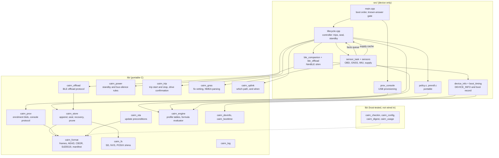

How it runs:

- **One controller owns all state.** The sensing task (its own task, on the core the controller does not use) only reports "facts" into a bounded queue; it never touches the card. The controller drains the queue, owns every lifecycle transition and is the only writer of frames. Overflow is counted and reported in the data (`DEVICE_HEALTH`), not hidden. Facts carry their own monotonic sample time, and the controller writes that time into the frame rather than the time it got round to writing it.
- **The sensing task owns the co-processor link.** OBD, GNSS and the supply voltage share one serial link, and every exchange holds `sensors_link_lock`; anyone else who needs the supply (controller, standby gate, uplink runner) reads the cache the sensing task publishes every 500 ms. Until 2026-10-23 the controller talked to the link itself, unlocked, and the interleaved replies cost a week of drives (see [Status](#status)).
- **Four independent regions** (capture, bundle, link, health), each with its own evidence. Every transition is recorded in the journal chain with the policy version in force, so a decision can be explained from the data alone. Health is a bitmap, not a severity: degradation is recorded, never a reason to stop capturing.
- **Boot order** is deliberate: logging first (RAM-buffered until the card mounts), then the card, then finish interrupted seals, then interrupted prunes, then open the capture. A capture left open by an earlier boot is sealed as it is and a fresh one opened (since `f940c84`): its frames are on that boot's monotonic clock, and one bundle must hold one clock. A trip that was active is still resumed as a trip; only the bundle is new. A format self-check (CRC-32 and SHA-256 known answers) must pass before capture; if the primitives in a build are wrong, the device refuses to write data the verifier would reject.

```mermaid
flowchart LR
    a["Log init and USB console"] --> b["Mount SD<br/>(retry, also from loop)"]
    b --> c["Create /cairn tree, attach SD log"]
    c --> d["Format known-answer check"]
    d --> e["Mark OTA image valid<br/>(if pending)"]
    e --> f["Load identity and storage root"]
    f --> g["Finish interrupted seals,<br/>then interrupted prunes"]
    g --> h["Seal a capture left by an earlier boot,<br/>open a fresh one"]
    h --> i["Start sensing task, then BLE"]
```

### Capture lifecycle

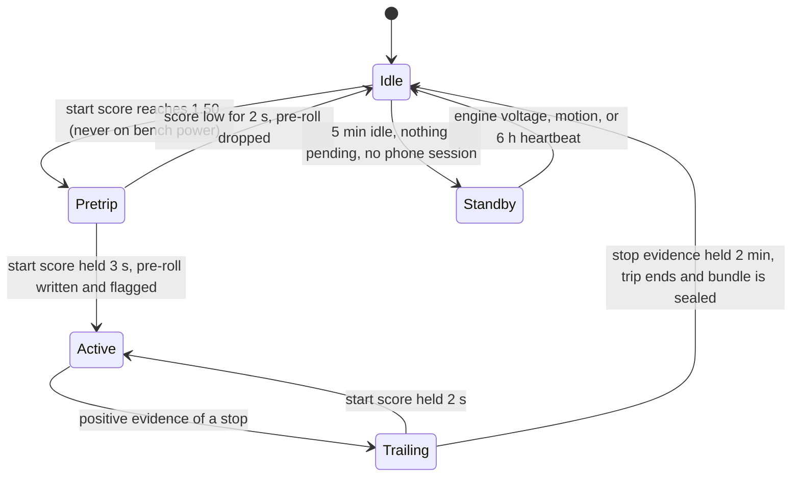

The decisions are made by `lib/cairn_trip` (since `6e62b44`), portable C fed one tick at a time by the controller and host-tested in `trip_test.c`; the controller performs the side effects.

- **Start.** The start score adds 1.00 for each of: a fresh OBD speed above 3 kph, a fresh *vetted* GNSS speed of at least ~10 km/h, and the engine confirmed running from the rail; the accelerometer, once its RMS reaches 120 mg, adds RMS ÷ 120 mg (so 120 mg is 1.00, 180 mg is 1.50). A trip starts when the score holds 1.50 for 3 s, so engine plus any one sign of movement starts one and an engine idling in the driveway does not. The score has 2 s of hysteresis: one low tick no longer restarts the dwell. Before `6e62b44` a running engine counted for nothing, and with OBD silent a smooth road (90–130 mg) scored 1.00 on GNSS alone.
- **Stop needs positive evidence**, not the absence of a strong signal: a fresh speed that is low (OBD ≤ 1 kph, GNSS under ~10 km/h) with the car quiet (< 120 mg); or, with no speed known, the engine off and the car quiet; or, with nothing else known, the accelerometer under 35 mg, which a moving car never reads (smooth driving reads ~87 mg at its lowest). Held for 2 minutes, it ends the trip. The stop score (0.40) is still computed and logged with each transition but no longer decides. Previously any stretch under 120 mg went to `TRAILING`; one trip lasted 8 s.
- **Pre-roll.** A 45 s ring (128 slots) so the start of a drive is not lost to the dwell.

The `include/config.h` thresholds are written into every bundle as a policy snapshot, still policy version 1; the rules in `lib/cairn_trip/cairn_trip.h` that now combine them (rail debounce, hysteresis, stop evidence) are not described there.

Sampling is event-adaptive: the nominal periods (GNSS 200 ms, IMU window 100 ms, OBD batch 200 ms, full OBD sweep 1.2 s, health every 30 s) are upper bounds, so adaptation only ever adds detail.

### Wi-Fi position scans

GNSS is missing exactly where a trip starts: a cold receiver takes a minute or two (the 2026-10-07 drive had its first fix 130 s in) and a garage gives none. The access points around the car are heard in both, so the dongle records what a Wi-Fi scan hears as a `WIFI_SCAN` record (format v3 §4.13, type `0x0C`) in the capture chain, and the server turns it into a position *estimate*, never a GNSS fix. The schedule is `lib/cairn_wifiscan` (host-tested in `wifiscan_test.c`); the radio side is `src/wifiscan_runner.cpp`.

- **Position scans** when there has been no accepted fix (one that passed the GNSS gate) for 5 s, or none since boot: every 10 s while a trip is suspected, under way or trailing, every 5 min parked.
- **Learning scans** when an accepted fix is no older than 2 s: every 60 s while driving, and once at trip start (confirmation) and trip end (entering the trailing dwell, while the record still lands in the trip's own bundle). They carry flag bit 0, so the server can learn where each access point is from the fixes beside it. The phone's fixes never count: in a garage they are themselves Wi-Fi positions.
- **Never while the uplink owns the radio.** No scan starts during a Wi-Fi slot, the home scan or an LTE send, and the uplink cancels a scan in flight before it takes the radio. Standby waits for a scan to finish. Wi-Fi is back at `WIFI_OFF` after every scan.
- **BLE stays up.** A scan is asynchronous (polled each tick, so capture is never blocked), passive by default (it sends no probe requests carrying the ESP32's fixed MAC), 200 ms per channel, about 2.6 s in all, with the coexistence arbiter on its balanced split. A slot tears BLE down because WPA2's handshake has a deadline; a scan has none. **Not yet verified on the car's unit:** that the phone link survives a scan, how many access points a passive scan hears under coexistence, and the heap left with both stacks up (`CAIRN_WIFI_SCAN=0` turns it off).
- **Privacy.** No SSID is ever recorded or logged; the per-scan log line gives counts only. An access point is left out when its BSSID is locally administered (bit 1 of the first octet: phone hotspots, randomised addresses) or its SSID ends in `_nomap` or `_optout` (matched case-insensitively). The 16 strongest are kept, strongest first; a scan that heard nothing is still written, with count 0. Scans taken before a trip is confirmed wait in two pre-roll slots of their own, since a 132-byte record does not fit the ring's 32-byte entries.

### Power and parked silence

On a BMW F3x the OBD connector carries only D-CAN, gated by the body domain controller, so any request while parked wakes the gateway and the car's energy management can count it. The firmware therefore enforces a named invariant, tested on the host: **no diagnostic request is transmitted unless a drive is confirmed**, and drive confirmation uses only bus-silent evidence: the rail at engine-on for 15 s, or the accelerometer at 120 mg or more for 10 s, or both together for 2 s. A periodic health wake never opens the bus.

Since `6e62b44` (`lib/cairn_trip`) the rail is **debounced**, because a garbled 9.000 V reading passes a 9–18 V sanity range: it counts as high while any high reading is under 5 s old, as low only after 5 s of nothing but low readings, and as unknown after 10 s without a valid reading; an unreadable sample is no information rather than a reset of the dwell. Confirmation is **latched for the life of a trip** (a stop at a light sags the rail, and auto start-stop cuts the engine) and released only by a valid low rail with the car still — never by an unreadable one, which used to close the bus mid-drive. The bus is opened for a trip, not for a `PRETRIP` candidate, which a door slam reaches; and OBD initialisation is requested the moment a drive is confirmed rather than at the next minute's retry.

Standby is not deep sleep: the ONE+ does not route the IMU interrupt to an RTC-capable pin, and timer-wake deep sleep would re-run the card recovery scan on every wake. Instead the radio and GNSS go off, the co-processor enters low power, the CPU drops to 80 MHz and the core light-sleeps between one-second polls. Standby is refused while a trip is open, while the capture is unsealed, or while sealed bundles are pending and a phone is connected. The draw is unmeasured.

## From capture to a sealed bundle

Everything on the card is bundle format v3, specified (with vectors) in the [contracts](https://github.com/ParkWardRR/cairn-driving-log-selfhosted/tree/main/contracts/format/v3). In outline:

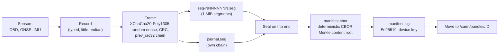

- **Records** emitted by this firmware: `GNSS_SAMPLE`, `IMU_SUMMARY`, `OBD_SNAPSHOT`, `OBD_EXTENDED`, `GNSS_GAP`, `TRIP_EVENT`, `POLICY_SNAPSHOT`, `STATE_TRANSITION` and `DEVICE_HEALTH`. `IMU_RAW_WINDOW` is defined by the format but not emitted. Phone-sourced GNSS fixes are stored with a source flag so they are never mistaken for the receiver's own. A receiver fix the plausibility gate refuses is not written at all and counts as no fix, so the gap shows as a `GNSS_GAP` rather than as a position.
- **Frames.** Each frame is a 24-byte header, a 24-byte random nonce, the encrypted payload, a 16-byte Poly1305 tag and a CRC-32 trailer (68 bytes of overhead, 4096 bytes at most). The segment header and frame header are authenticated data, so a frame cannot be moved between segments or edited. Each frame cites the CRC of the previous one, forming a chain; a gap, splice or reorder is detectable.
- **Keys.** A random 32-byte root key (`K_root`) lives in NVS. Each segment's key is `HKDF-SHA256(K_root, salt = vehicle_id, info = "cairn/segment/v3" plus the device, assignment, boot and segment ids)`. The server holds an escrowed copy of the root (see enrolment); the phone never does.
- **Recovery needs no key.** The boot scan is structural: it checks CRCs and the chain, truncates a torn tail to the last valid frame and records the exact discarded byte count in the manifest, so a bundle reports being short instead of looking complete. A device that has lost its key still seals what is on the card.
- **Durability.** Flush every 4 frames or 1 s (since 2026-10-14; it was 32 frames or 5 s), and immediately when the supply rail drops at ignition-off, so a power cut costs about a second. The device counter that defends against rollback is reserved durably before the first segment header names it and committed again before the manifest is signed, so a power cut cannot hand one counter to two different bundles; a reserved but never-sealed counter is a hole the server reports, the harmless direction.
- **Seal** hashes the members, builds and signs the manifest (written before the directory is moved, so an interrupted seal is always completable without re-signing), then moves `capture/<id>` to `bundles/<id>`. A sealed bundle is never modified.
- **Identity.** A bundle's operational handle is a ULID directory name; its real identity is the content root. Ordering truth is `(boot_id, seq)`, never wall-clock UTC, which is recorded only as an annotation with its own accuracy.
- **Limits.** At most 16 members and 64 chunks per bundle; if the budget is exhausted the controller seals at the next opportunity rather than fabricate continuity.

The card layout:

```text
/cairn/capture/<ULID>/      the one open, unsealed bundle
/cairn/bundles/<ULID>/      sealed, awaiting a receipt:
    seg-00000000.seg ...    capture frames (one chain across segments)
    journal.seg             transitions and health (own chain)
    manifest.cbor           the exact bytes that were signed
    manifest.sig            64-byte Ed25519 signature
/cairn/receipts/<ULID>.cbor verified receipts
/cairn/state/               prune intent journal
/cairn/logs/                verbose boot logs (capped, yields to capture)
```

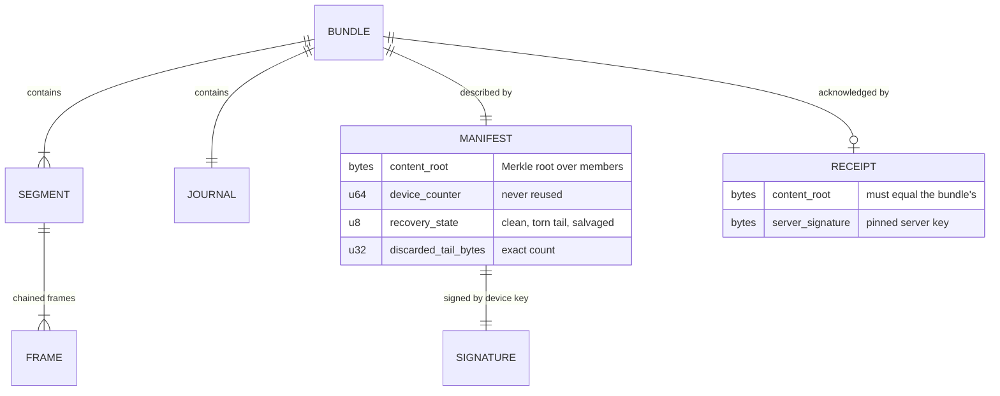

Logs: one file per boot under `/cairn/logs`, monotonic timestamps (never UTC), and an 8-hex boot-id prefix tying lines to bundles. Below 64 MiB free the SD log sink switches itself off and logging continues over UART only; the log tree is capped at 16 MiB, oldest first. A debugging aid must not cost a trip.

## BLE service and bundle offload

The dongle advertises as `Cairn` with the service UUID `A8E30000-4F5B-11EF-A017-325096B39F47`. The wire formats are the [BLE protocol v1 contracts](https://github.com/ParkWardRR/cairn-driving-log-selfhosted/tree/main/contracts/ble/v1) (`spec.md` and `offload.md`); this firmware implements:

| Characteristic | Suffix | Direction | Purpose |
|---|---|---|---|
| `PROTOCOL_VERSION` | `00F0` | read | `{version 1, capabilities}`; bit 0 phone GNSS, bit 2 offload (only if the offload task actually started), bit 3 device information |
| `GNSS_FIX` | `0001` | phone to dongle, write without response | 28-byte phone location, used when the receiver has no fix |
| `GNSS_QUALITY` | `0010` | notify | receiver fix type, satellites, HDOP, fix age |
| `COMPANION_STATUS` | `0011` | notify | accepted, rejected and dropped fix counters |
| `DEVICE_INFO` | `0040` | read | firmware, identity, storage, transport, installed engines and boot timing, as a versioned record list (see [below](#device-info-and-boot-timing)) |
| `OFFLOAD_CONTROL` | `0030` | write and indicate | offload requests and responses |
| `OFFLOAD_DATA` | `0031` | notify and write without response | bundle bytes out, receipt bytes in |

The Phase 2 characteristics of the contract (`BARO_ALT`, `UTC_SYNC`, `OBD_LIVE`, `DEVICE_STATUS`) and the check-in characteristics `0041` to `0044` are not created, and their capability bits stay clear: a bit for something absent would be a lie the app is told to trust.

**Pairing and access** *(target state — the shipping build)*. LE Secure Connections with bonding and man-in-the-middle protection; the dongle is display-only and uses a static six-digit passkey from `secrets.h`. Every characteristic requires an encrypted, authenticated link, so an unbonded phone can discover the dongle but read, write or subscribe to nothing. One bond is kept (`CONFIG_BT_NIMBLE_MAX_BONDS=1`); a new bond replaces the old. A phone fix is accepted only if it is under 3 s old, flagged position-valid and not a repeated sequence number.

> ⚠ **Current flashed build (2026-10-06) is a dev build.** To unblock the first over-the-air offload, this build pairs with **Just Works** (`BOND|SC`, IO cap `NO_INPUT_OUTPUT`, no MITM), drops `READ_AUTHEN`/`WRITE_AUTHEN` from characteristic flags (reads require encryption only), and clears its bond only when the pairing configuration (mode or passkey) changes, so a stale bond from a prior passkey cannot block the new link while a normal reboot keeps the phone paired (an iPhone refuses a dongle that forgot its bond at every ignition until the person forgets it in Settings). It also auto-detects **bench mode** from the raw co-processor voltage (3–7.5 V = USB-only, no OBD rail) and keeps the radio and MCU up while bench mode is latched. The receipt gate (Ed25519 at the application layer, verified in `ble_offload` against `CAIRN_SERVER_RECEIPT_KEY_HEX`) is unaffected. **Flip MITM + `DISPLAY_ONLY` back, restore the AUTHEN flags, and keep the pairing-change bond reset before any build goes into a car that is not yours** — the dev build is BLE-link weak on purpose.

### Offload and the receipt-verified prune

The offload module (`lib/cairn_offload`) is plain C with no BLE dependency, so the framing, the refusals and above all the receipt gate run on the host against exactly the code the device runs. A thin NimBLE shim copies bytes into a queue and a dedicated task runs the module (NimBLE's own task stack is too small for Ed25519 and card reads).

Rules of the protocol:

- Operations: `LIST`, `GET_MANIFEST`, `READ`, `PUT_RECEIPT`, `ABORT`. One at a time; a second request gets `BUSY`.
- **Refused while a trip is in progress** (`TRIP_ACTIVE`): any capture state other than idle. Offload competes with capture for the card, and capture is never degraded to serve a transfer. If the controller cannot tell, the answer is "active". A bundle only exists to offload once sealed, a couple of minutes after you stop.
- Needs an MTU large enough for one list entry (payload of at least 40 bytes), else every request answers `IO_ERROR`. The firmware sets its own MTU to 185.
- Transfers end with a done indication carrying the byte count and an IEEE CRC-32; the phone re-reads a range if either is wrong. An operation that makes no progress for 8 s is abandoned. A disconnect abandons everything and scrubs the receipt buffer.
- An active offload keeps the dongle out of standby, bounded (120 s inactivity window, 15 minute cap per connection) so a phone that stays connected cannot keep it awake forever.

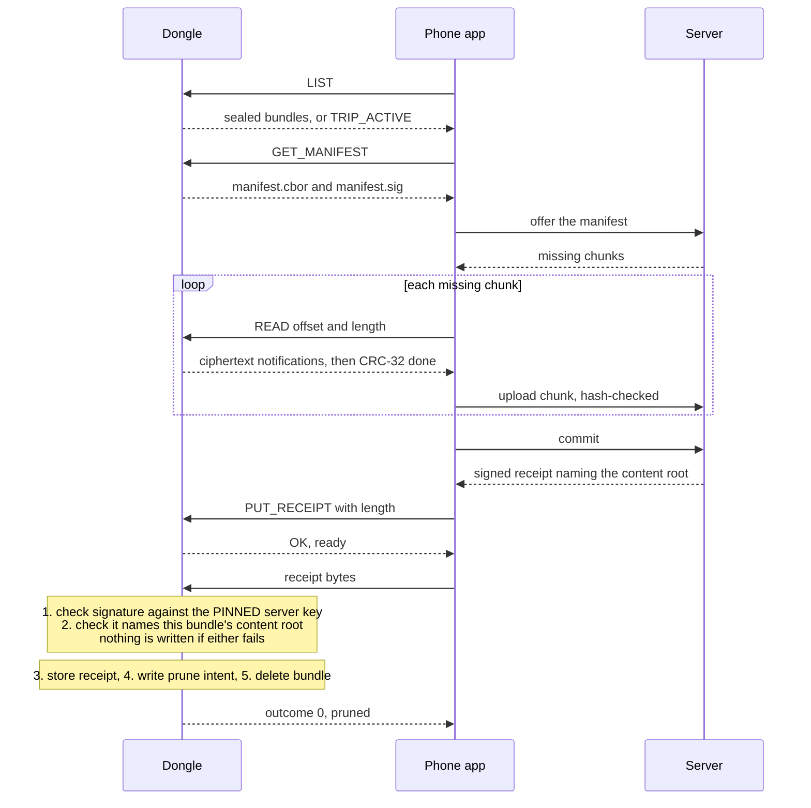

**The gate.** `cairn_receipt_check` verifies a receipt before anything touches the card, so a forged receipt cannot overwrite a genuine stored one. A prune requires both a valid signature under the key pinned in `secrets.h` and a matching content root. The prune writes an intent record first, so a power cut mid-delete is recognised and finished at the next boot. If the key is the all-zero placeholder the dongle hands over bundles but never prunes: a full card loses nothing, a wrongly authorised prune loses a trip permanently.

| Outcome | Meaning |
|---:|---|
| 0 | Verified and pruned |
| 1 | Verified and stored; the delete did not finish (completed at boot) |
| 2 | Rejected: malformed, or the signature does not verify (server and pinned key disagree) |
| 3 | Rejected: genuine receipt for different content |
| 4 | No key pinned in this firmware; nothing stored or deleted |

A failed upload (out-of-sequence frame, too many bytes, stall, trip start) ends with the `0x84` indication, a non-zero status and no outcome byte; nothing is stored or deleted.

## Enrolment and provisioning

The dongle generates its own Ed25519 identity on first boot, so it cannot be enrolled in advance: the server must be told a public key that does not exist until the hardware has run once. Everything happens over the USB console. The wire format is the [enrolment v1 contract](https://github.com/ParkWardRR/cairn-driving-log-selfhosted/tree/main/contracts/enrolment/v1); the operator procedure is `docs/device-provisioning.md` in [cairn-vehicle-server](https://github.com/ParkWardRR/cairn-vehicle-server).

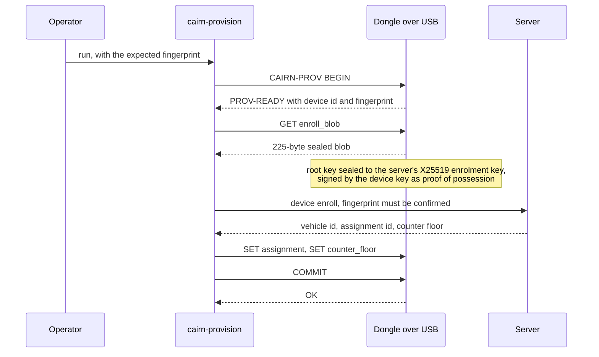

Rules the firmware enforces (and the host tests attack):

- **Never during a trip.** An unassigned dongle accepts a session at any time; an assigned one only in the first 60 s after boot, so an unattended unit cannot be reprovisioned by someone who plugs in later. A session idles out after 30 s and its staged values are scrubbed.
- **No secret is echoed or logged.** A host test sends a canary through every path and asserts it appears in no reply and no log line.
- **All-or-nothing commit.** The assignment and the counter floor are idempotent, and the floor only ever rises (lowering a counter is exactly the rollback the counter exists to defeat), so a failed `COMMIT` is safe to send again.
- **It refuses to seal to a key nobody holds.** With the all-zero placeholder enrolment key in `secrets.h` the dongle produces no blob.
- **No network credentials exist to provision.** `SET wifi_ssid` and its relatives are answered `unknown field`. At boot the firmware also erases Wi-Fi and client-certificate material left by older firmware and zeroes every deleted NVS entry in place on each boot, so deleted credentials do not stay readable in flash (an earlier page-recycling scrub was best effort and missed the Wi-Fi stack's saved password). The live entries, the device identity among them, remain readable over USB: only flash encryption makes the chip itself safe, and this unit cannot be given it ([Security posture](#security-posture)).

**One dongle, several cars (`SET garage`).** Provisioned with a garage of up to four cars (one open assignment and engine profile each), the dongle boots assuming the car it was last in and lets the VIN decide once the ECU answers: a car whose VIN it has seen before, else the one car whose engine the VIN names (BMW VDS positions 4-8, `engine_codes` in `engines/*.yaml`). On a different car it switches assignment and seals the open bundle (bundle seal reason 4); if nothing matches, or two cars share the engine and neither VIN is known yet, it stays with the car it assumed and says so. Only a truncated SHA-256 of a VIN is stored. Unplugging powers the dongle off, so a swap is always a new boot, and the server files a boot under the car it identified last (`lib/cairn_garage`, `test/host/garage_test.c`).

An unassigned dongle still captures and seals ("data first"), but the server refuses such bundles until an assignment exists. Physical access to the USB cable remains the trust boundary until flash encryption is on; the rules narrow what a person with a cable can do, they do not remove it.

## secrets.h

`include/secrets.h` holds three build-time values. It is gitignored; the template is `include/secrets.h.example`, which holds placeholders only:

```c
// include/secrets.h  (never commit; copy from secrets.h.example)
#define CAIRN_SERVER_ENROLL_PUBKEY_HEX "<64 hex chars: server X25519 enrolment public key>"
#define CAIRN_SERVER_RECEIPT_KEY_HEX   "<64 hex chars: server Ed25519 receipt-signing public key>"
#define CAIRN_BLE_PASSKEY              <six digits you choose>
// optional: pin an update key to switch the OTA gate on
// #define CAIRN_UPDATE_KEY_HEX        "<64 hex chars: Ed25519 update public key>"
```

| Value | Where it comes from | If left as the placeholder |
|---|---|---|
| `CAIRN_SERVER_ENROLL_PUBKEY_HEX` | `cairn-server -print-enroll-key` | the dongle refuses to emit an enrolment blob |
| `CAIRN_SERVER_RECEIPT_KEY_HEX` | `cairn-server -print-receipt-key` | bundles are handed off but **never pruned**; the card fills rather than losing a trip |
| `CAIRN_BLE_PASSKEY` | you choose | the template value is public, so pick your own; the BLE build stops with an error if no passkey is defined |
| `CAIRN_UPDATE_KEY_HEX` | `cairn-signfw -genkey`, then `-print-public` | OTA stays off (undefined means off) |

All of these are public keys or a pairing passkey; none is a signing key. The receipt key is pinned on purpose: receipts are verified against it, never against a key supplied in a response, because a receipt is what authorises a deletion. Without a `secrets.h` the project still builds (config falls back to placeholders) but cannot enrol or prune, so check the boot log after flashing instead of assuming.

## OTA and the A/B partitions

`partitions-ab.csv` lays out two application slots from the first flashing, because retrofitting OTA onto a device wired into a car means pulling it out; the slots cost nothing, their absence is unrecoverable.

| Partition | Offset | Size | Holds |
|---|---|---|---|
| `nvs` | `0x009000` | 20 KB | boot count, policy and counters, device key, storage root |
| `otadata` | `0x00e000` | 8 KB | which slot is active and its rollback state |
| `app0` | `0x010000` | 1.69 MB | OTA slot A |
| `app1` | `0x1c0000` | 1.69 MB | OTA slot B |
| `nvs_keys` | `0x370000` | 4 KB | reserved for NVS encryption keys (flash encryption is not enabled) |
| `errlog` | `0x371000` | 64 KB | error and reboot-cause journal |
| `coredump` | `0x381000` | 64 KB | panic dumps, so a parked-car crash is diagnosable |

The table fits in the first 4 MB; the chip has 16 MB, so about 12 MB is deliberately unused (changing the configured flash size alters the bootloader header, a boot-loop class of risk, for no benefit today).

**What exists.** After the card mounts and the format check passes, an image that booted from a fresh OTA slot marks itself valid (`esp_ota_mark_app_valid_cancel_rollback`); otherwise the bootloader rolls back at the next reset, and the boot log says when that happened. The update gate in `lib/cairn_ota` and `lib/cairn_format` is host-tested: a signed update descriptor (version, image SHA-256, length, minimum version) verified against a pinned **update key that is separate from the receipt key**, strict version ordering (an unparseable version is refused, never guessed), and four preconditions: no unreceipted bundles, parked, healthy supply, update key pinned.

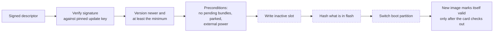

The dashed steps do not exist yet. Nothing fetches an image, writes the inactive slot, reads it back to hash it, or sets the boot partition. `docs/ota.md` documents the intended ordering (verify the descriptor first, write the inactive slot, hash what is actually in flash, switch last) and still shows the retired HTTP endpoints; delivery is planned over BLE. Pinning an update key only enables the gate.

## Security posture

The full plan, with the irreversibility table and a verification checklist, is [docs/esp32-hardening.md](docs/esp32-hardening.md). The short version:

**The chip.** Measured on the real unit: ESP32-D0WDQ6, **revision v1.0**, the oldest silicon. **Secure Boot V2 needs revision v3.0 or later and is not available on this unit.** Only the weaker V1 scheme is possible, with its own limits (bootloader size and layout, a one-time key burn). Flash encryption is available on every revision, but on v1.0 the number of plaintext re-flashes in development mode is a tightly limited counter. The unit currently has neither enabled (flash encryption counter 0, secure boot off, JTAG and UART download left available). Enabling any of it is irreversible and is not planned on the only unit in the car. The plan is to prove signed OTA first, move to an ESP-IDF configuration (`sdkconfig.defaults`) so these options can be set at all, rehearse on a second unit — **none has been bought; there is exactly one dongle** — and consider a newer ONE+ for the car.

**The credential gate, and how it was answered.** Issue #18 first decided that network credentials wait for flash and NVS encryption (#7). Read against the hardware above that is not a step waiting its turn, it is a dead end: encryption is an eFuse burn, burns are ruled out on the only unit, there is no spare to rehearse on, and the stronger secure boot is unavailable on revision v1.0 regardless.

**Decided 2026-10-07:** the condition on Wi-Fi (#15) and LTE (#16) is now #18's third option instead — a credential store the chip cannot open by itself. Credentials are held encrypted under a key derived with the server's help (the device root is already escrowed there), so a dumped chip yields ciphertext rather than an SSID and a password. This does not claim the chip is protected; everything under "Known limits" below still holds, and `K_root` and the signing seed remain readable from an extracted chip. It only keeps the network credentials out of that dump.

**What that leaves to settle, before any credential is stored.** Where the key lives between boots is the whole problem and is not decided. Hold it only in RAM and a dongle that reboots alone cannot rejoin a network until the phone or the server hands it back; write it to NVS and it is a plaintext secret again under a longer name. BLE is the dongle's home state and the phone is usually present, which is what makes an unwrap at connection plausible, but that is a sketch, not a design. Until it is written down with the same rigour as the format and enrolment contracts, the transports are designed, not planned.

**What applies instead, today.**

| Layer | What protects what |
|---|---|
| SD card | Application-layer encryption (XChaCha20-Poly1305 per frame, HKDF-derived per-segment keys); the card is never the security boundary |
| Integrity | Frame CRC and hash chain, signed manifest (Ed25519, device key), Merkle content root, monotonic device counter against rollback and cloning |
| Deletion | Receipt gate: pinned server key, matching content root, intent journal |
| Network | Wi-Fi and LTE uploads over mTLS with a pinned CA, TLS verified on the ESP32; the credentials are compiled in and readable from a flash dump (see the credential gate above) |
| Radio | BLE bonding with MITM-protected Secure Connections and a passkey; encrypted and authenticated characteristics; the phone carries ciphertext only *(target state; current flashed build is a dev build with Just Works pairing — see the "Pairing and access" caveat above)* |
| Console | USB provisioning never during a trip, 60 s window when assigned, no secret echoed or logged |
| Updates (design, host-tested gate) | Separate update key; signature before download; hash read back from flash; boot partition switched last; rollback on a failed self-check |
| Stolen, running dongle | Not solved by hardware. Handled by revocation on the server and a short exposure window |

**Known limits, stated plainly.** Without flash encryption the device signing seed and `K_root` are readable from an extracted chip (the seed authorises uploads, not deletions, and the server can revoke it); the key hierarchy in the hardening doc shows the target state, not the current one. A physically present attacker can reflash over serial. The USB console is trusted as far as the cable.

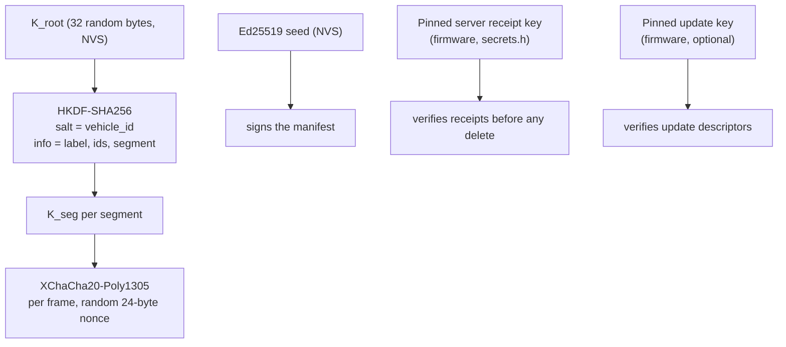

## Engine profiles

Engine- and vehicle-specific behaviour lives in one YAML file per engine under `engines/`, not in the code: which OBD PIDs to ask for, how to turn each reply into the value the capture record stores, the cadence, what supply voltage means "engine running", and the standby dwells (the profile also states drive-confirmation dwells, which `lib/cairn_trip` does not read yet). A build carries all engines or only the ones you choose, without forking the firmware.

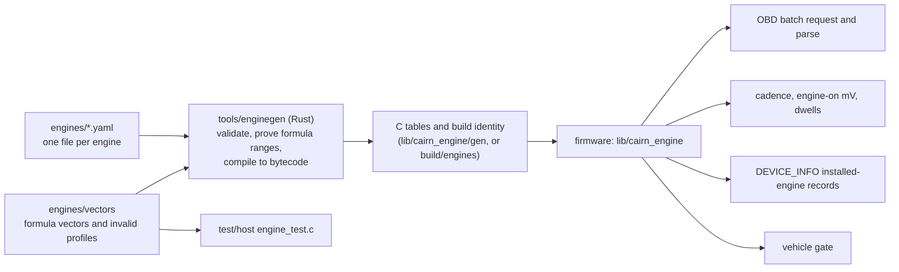

What is in the repository:

| Path | What it is |
|---|---|
| `engines/bmw-n20.yaml` | BMW N20/N26 (F32 428i), status `derived`: every number and formula was extracted from what the firmware hard-coded before, and `engine_test.c` proves each one equal, exhaustively over every possible input byte |
| `engines/bmw-b58.yaml` | BMW B58 (M240i), status `stub`: identity only; the generator rejects a stub that states anything |
| `.contracts/contracts/engine/v1/` | **The schema, the normative text and the vectors are the contract's, not this repository's** (`contracts/engine/v1`, pinned by `contracts.lock`). They moved there on 2026-10-08; keeping a second copy here is the drift that contract was created to end. `acquisition.schema.json`, `spec.md`, `vectors/expr.txt` (formula vectors: expressions with inputs, expected values and exact bytecode; expressions the compiler must reject; raw bytecode with the value or error an evaluator must produce) and `vectors/invalid/*.yaml` (profiles that must be rejected, each stating the error it must produce). Set `CAIRN_CONTRACTS` to a checkout to change a contract and this generator together |
| `tools/enginegen/` | The generator (`validate`, `gen`, `list`, `identity`, `vectors`, `eval`) and its tests |
| `lib/cairn_engine/` | The runtime: profile selection, the integer-only formula evaluator, batch request building and reply parsing, the vehicle gate, and the committed all-engines header in `gen/` |

Rules worth knowing:

- **`unknown` is an answer; a missing key is an error.** A value nobody has established is written `unknown`, and the firmware then uses its own device default (the values in `include/config.h`) and can say which values came from the profile. It never borrows another engine's number.
- **Formulas cannot misbehave.** The language is integer-only with no state, loops or calls, every operation must stay inside int32 (nothing wraps), and the generator proves from interval analysis that an accepted formula cannot divide by zero, shift out of range, overflow, or produce a value outside its declared range. The evaluator still checks at run time, because bytecode in flash is only as trustworthy as the flash. A formula yields the value exactly as the capture record stores it, including saturation.
- **Hot and cold PIDs.** Up to six `hot` PIDs share one multi-PID Mode 01 request every cycle; `cold` PIDs are asked one at a time, one slot per cycle.
- **Vehicle gate.** A build can declare the engine it is for (`-DCAIRN_VEHICLE_ENGINE_ID`). If the vehicle is declared or positively identified as needing an engine this build does not carry, or the active profile has no PID table, the firmware refuses to open an OBD session and says so, rather than record data with the wrong table.
- **Identity.** Each profile has a hash (SHA-256 of the file, CRLF read as LF) and each build an identity over its selected engines; the firmware logs both at boot and reports them in `DEVICE_INFO`. The hash is provisional until the engine contract defines canonical bytes.
- **Draft.** `contracts/engine/v1` is unreleased; the schema, specification and vectors live beside the profiles and are meant to move into the contract. Treat nothing here as a stable interface.

Build with a selection (the generator validates first, so an unknown or invalid engine stops before PlatformIO starts); a plain `pio run -e cairn` uses the committed all-engines tables:

```sh
make firmware ENGINES=all                       # every engine in engines/
make firmware ENGINES=bmw-n20                   # or only the ones named, comma separated
make firmware ENGINES=bmw-n20,bmw-b58 ENV=cairn-selftest
make engines-gen                                # regenerate the committed header after editing engines/
make engines-check                              # what CI runs: validate, vectors, header up to date, tests
```

The PID support and formula research for the BMW N20 is in `research/research_notes/BMW N20 OBD PID support/`. Two optional discovery builds find out what a given car answers: `cairn-pidtest` (the support bitmaps and the raw reply beside the converted value for each PID) and `cairn-mtprobe` / `cairn-mtprobe-sniff` (the manual-transmission probe, see `docs/manual-transmission-probe.md`).

## Device info and boot timing

**Device information** (`lib/cairn_devinfo`, `src/device_info.cpp`; [docs/device-info.md](docs/device-info.md)). Characteristic `0040` is a read-only, bonded-link-only, versioned list of records the phone uses to show what it is talking to: firmware version and build, secure-boot and flash-encryption state, device id and fingerprint, enrolment state, storage free and pending bundles, transports present, every installed engine (id, version, hash prefix) and the boot timing. The encoder and decoder match every vector in the contract (including a newer minor version with an unknown record, the 512-byte cut and the malformed values, which are refused). It reports only what it knows: LTE is not claimed, `enrol_state` cannot tell "enrolled with no vehicle" from "not enrolled", and the build time is the compiler's clock read as UTC. A long read of up to 512 bytes over a 185-byte MTU has not been checked on a real phone.

**Boot timing** (`lib/cairn_boottime`, `src/boot_timing.cpp`; [docs/boot-timing.md](docs/boot-timing.md)). Boot speed and time to upload are owner priorities, so the firmware records a monotonic timestamp at each boot stage and prints the deltas once capture and BLE are both up.

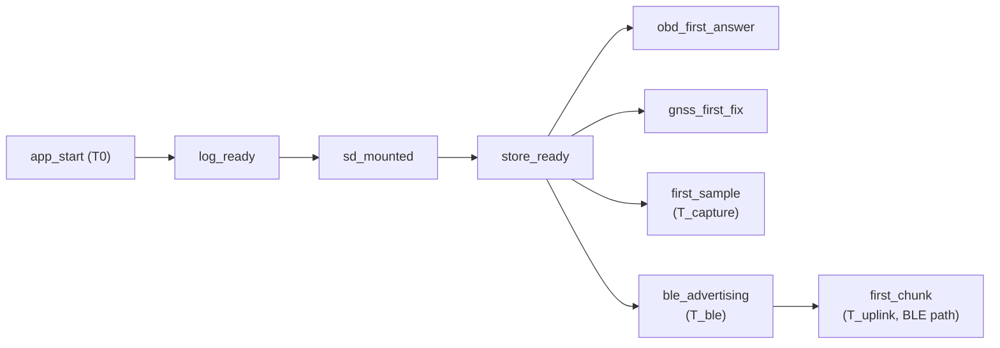

The first mark of a stage wins, so BLE re-advertising after a drive does not overwrite the boot value. A budget check (`cairn_boottime_check`) exists so a regression could be seen without hardware, but no budget is committed because **no boot has been measured on the unit yet**. Safety is not traded for speed: the counter commit, torn-tail recovery and the receipt gate stay.

## Host-tested cores that are not wired in yet

These modules are built, tested on the host and documented, but nothing in `src/` calls them. They exist so the logic is settled and attacked before a radio or a credential is involved. Where a contract is unreleased the module says **provisional**, and what is isolated (the envelope, the wire bytes) is the part expected to change.

### Check-in: signed instructions and the home trigger

`lib/cairn_checkin` implements `contracts/ble/v1/checkin.md` (still draft; [docs/check-in.md](docs/check-in.md)). When the dongle is back on BLE after a Wi-Fi slot the phone may deliver a small closed set of instructions: `UPLOAD_NOW`, `STOP_TRYING` (1 to 168 hours), `CLEAR_STOP` and `CONFIG`, each signed by the **server** with an instruction key pinned in firmware. The phone only carries them and cannot forge, alter or replay one. An unsigned 6-byte `HOME_TRIGGER` ("you may use Wi-Fi now") is accepted separately, for at most 900 s, never during a trip, and held in RAM only.

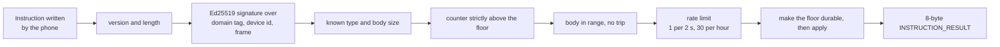

Why it is not wired: it needs the pinned instruction public key (a build-time trust anchor like the receipt key, which `secrets.h` does not have yet), and a remote-control surface should not go live untested on a car, so the characteristics are not created and the capability bits stay clear. The doc lists where it deliberately differs from the contract (persist before the effect, an extra `STORE_FAILED` status) so those can be raised with the contract.

### Configuration receiver

`lib/cairn_config` is what the dongle does with a sealed configuration message from the web UI or iOS app, delivered through a `CONFIG` instruction or an authenticated uplink session ([docs/config-receiver.md](docs/config-receiver.md)). **Provisional:** the config contract is unreleased, so the envelope uses only primitives the enrolment contract already has.

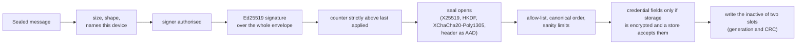

A rejected message does not consume the counter; attempts are rate limited (10 per minute); a rolled-back message cannot be replayed because rollback keeps the counter. Credentials (APN, SIM PIN, Wi-Fi networks, including the home-network list) are refused today, as a whole message: there is nowhere to put them that a flash dump would not read (see [Security posture](#security-posture)). The doc lists the open points the contract must settle (how the server learns the device's configuration public key, who may sign, and the 440-byte instruction body leaving only about 240 bytes of payload).

### Uplink manager

`lib/cairn_uplink` is the policy that decides which path moves a bundle and when the radio may leave BLE ([docs/uplink-manager.md](docs/uplink-manager.md)). It is portable C with the clock and every outside fact passed in. BLE is the home state; the one radio is time-sliced, never shared.

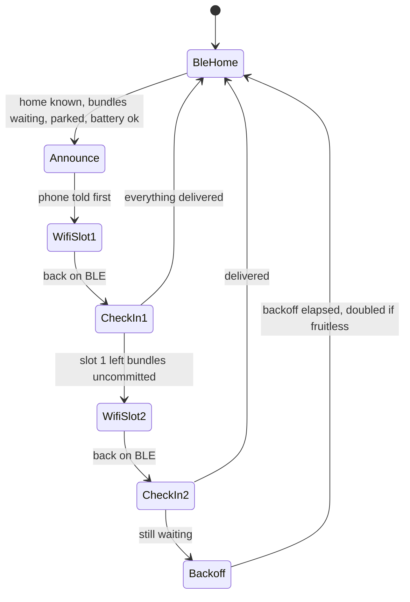

BLE and Wi-Fi are never up together; a connected phone is told before the radio leaves BLE; a trip start, low battery or the slot limit aborts a slot and a stuck caller is forced off; and a delivery ends in a prune only through the receipt gate, so a refused receipt deletes nothing and the next path is tried. A second path resumes from the chunks the server already holds. Home is either phone-asserted (the dongle stores no location) or, with no phone, a bounded, rate-limited scan that runs only when parked with bundles waiting. LTE for whole bundles only if the user allowed it. The slot lengths and backoffs are placeholders to be set from measurement. Unlike the rest of this section it **is** wired in: `src/uplink_runner.cpp` has run it in `env:cairn` since 2026-10-07 (see [Status](#status)).

### LTE digest and data accounting

Both are **provisional** (the digest and config contracts are unreleased; no contract vectors exist) and secret-free.

- `lib/cairn_digest`: a streaming trip reducer with a hard byte budget. It keeps at most K route points (dropping the interior point whose removal changes the path least), accumulates summary statistics, and encodes within a budget clamped to a compiled-in ceiling, reducing the route and then the event list rather than exceed it. The plaintext digest contains locations, so it never goes to flash or the card; sealing it is a hook with no default, so an unsealed digest is not shippable. A digest acknowledgement can never authorise a prune: that rule has its own test against the real prune gate.
- `lib/cairn_usage`: byte counts per path (LTE, Wi-Fi, BLE) per day and billing period, and the single gate that decides whether LTE traffic may start or continue, with a reason for every refusal. Caps (monthly, daily, per trip) are clamped by compiled-in ceilings; only an authorised signed message can raise a runtime ceiling, and nothing past the absolute maximum. LTE is off until someone turns it on, with digests only by default and roaming off. A persisted attempt limit, per-trip backoff and a circuit breaker survive a reboot loop. Counts err toward over-counting, so a power cut can make the dongle stop early, never run past a cap.

## Tests

The principle: compiling for the ESP32 proves nothing about crash and adversarial behaviour, so the same C sources the device runs are compiled natively and attacked.

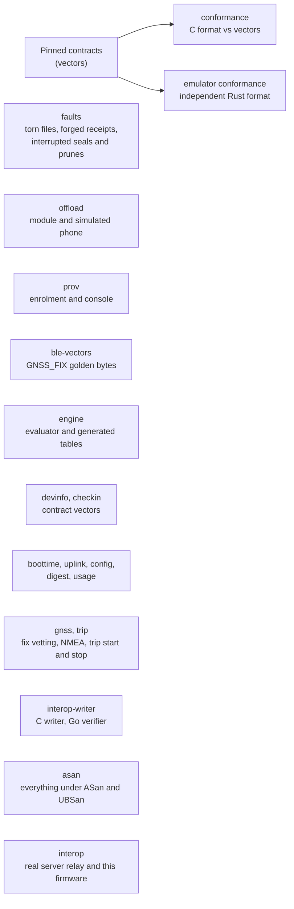

| Suite | What it proves |
|---|---|
| `conformance` | `lib/cairn_format` agrees byte for byte with the Go reference on the pinned format v3 vectors, positive and negative, each checked structurally (no key) and keyed. Ed25519 signing is checked by reproducing the committed signature (it is deterministic). The primitives are first checked against their own published known answers |
| `faults` | The storage property matrix over a POSIX filesystem: torn segments mid-frame and mid-header, flipped bytes, forged and wrong-bundle receipts, interrupted seals and prunes, counter rules, OTA preconditions, update descriptors, pre-roll. Rows assert what is on disk, not what a log said, and are reproducible from a printed seed |
| `ble-vectors` | The phone-GNSS wire layout against the golden vectors from an independent implementation |
| `prov` | X25519 against RFC 7748, the enrolment blob against the Go reference, window, trip and idle rules, atomic commit, the canary no-leak check, legacy slot erasure |
| `offload` | The offload module over real sealed bundles: framing, refusals, MTU, stalls, and the receipt gate under attack (forged receipt, genuine receipt for the wrong bundle, no overwrite of a stored receipt) |
| `mtprobe` | Reply parsing for the manual-transmission probe |
| `engine` | The formula evaluator against `engines/vectors`, the generated N20 tables against the previously hard-coded values (every input byte), and the vehicle gate; run against the committed all-engines tables and, in `make engines-check`, against each selection a build can produce |
| `devinfo`, `checkin` | `DEVICE_INFO`, `UPLINK_EVENT`, instructions and the home trigger against the contract's vectors (`ble/v1/vectors/device-info`). The rows are skipped, with a message, on a contracts pin that lacks them |
| `boottime`, `uplink`, `config` | The boot record and budget check, the uplink schedule and its safety rules, and the configuration receiver, over synthetic inputs (their contracts are unreleased) |
| `digest`, `usage` | The digest reducer and byte budget, the rule that a digest acknowledgement is not a receipt (against the real prune gate), data accounting, caps, power-cut persistence and the retry breaker. Provisional: synthetic data, no contract vectors |
| `gnss` | `lib/cairn_gnss`, 37 checks: the plausibility gate (the 37 phantom fixes of 2026-10-14 replayed and all refused, the real fixes before them all accepted, each of `SETTLING`, `OBD`, `STILL`, `ACCEL`, and pulling away from a light, which must be accepted) and the 5 Hz NMEA parser (GGA/RMC pairing, checksums, repeats across polls, stale buffers, truncation, an unpaired GGA, the midnight wrap) |
| `trip` | `lib/cairn_trip`, 22 checks: the drive lost on 2026-10-23 (half the rail readings garbage, OBD silent, a 90–120 mg road) replayed as one 20-minute trip started within 30 s; idling for 10 minutes, door slams and bench power never start a trip; traffic lights with auto start-stop and tunnels do not split one; parking ends it |
| `interop-writer` | Seals bundles with the C store and format code and leaves them for the server's Go verifier to judge |
| `mutate` | Applies deliberate breakages of the digest and usage safety rules to a copy of the sources and requires the suite to fail on each (`make -C test/host mutate`) |
| `asan` | All of the above under AddressSanitizer and UBSan, since undefined behaviour in the scan path would be a parser reading past a torn segment |

**Rust emulator** (`emulator/`). A second, independent implementation of the format (frames, AEAD, CBOR, manifest, receipts, update descriptors) with two commands: `conformance` runs it against the same pinned vectors, and `fault-matrix` runs a property matrix of local durability rows (no server needed) plus protocol rows against a live server, either the legacy device listener (`--server`) or, as the phone would, the server's relay (`--relay`, with an invitation code the first time). It no longer simulates drives. Two independent implementations agreeing on committed bytes means neither can quietly drag the other along.

**Interop.** `offload-sim` is the real offload module on a pipe, standing in for the dongle in the server repository's Go test. The server's CI runs the full interop script against a firmware commit it pins (required there). Here, `.github/workflows/interop.yml` runs it the other way round every Monday (and on demand): this firmware against the server's current `main`. It is a diagnostic, not a gate: red means look, not revert. It runs three things. `scripts/interop-writer.sh` has the server's `cairn-verify` judge the bundles the C writer produces, then applies deliberate mutations to a copy of the C sources and requires the verifier to reject what the mutated writer seals (`--mutation-check`), so a wrong CRC or frame layout cannot pass unseen. `scripts/relay-interop.sh` builds the server from a checkout into a temporary directory, enrols the emulator as a phone and runs the emulator's protocol rows over the real `/v1/relay/bundles/*` path, including rows only the relay has (reordering, early commit, forged receipts and offers, caller forgery and replay), and `--selftest` proves the run can fail. Finally the server's own interop script runs against this checkout. Neither script modifies the server checkout.

**CI** (`.github/workflows/ci.yml`) runs on the self-hosted `cairn` runner, never a hosted one, and only for pushes and for pull requests from this repository (a fork's pull request never reaches it; `tests/check-runners.sh` enforces this). Jobs: runner policy; the host suites with ASan and UBSan; three target builds (production, self-test, and one with an update key pinned so the OTA path compiles); `engines` (`make engines-check`: validate every profile, check the formula vectors and the invalid-profile vectors, require the committed all-engines header to equal a regeneration, run the generator's tests, and run the firmware's engine tests against one-engine and all-engines selections); and the emulator's tests, conformance and local durability rows.

## Repository layout

| Path | What it is |
|---|---|
| `src/`, `include/` | The application: boot, lifecycle controller, sensing, BLE companion and offload shim, device info, boot timing, USB provisioning, standby. `include/config.h` holds policy constants, `board_config.h` pins and layout, `secrets.h.example` the template |
| `lib/cairn_format/` | Format v3: frames, AEAD, CBOR, hashes, HKDF, Ed25519, manifest and update descriptors |
| `lib/cairn_store/` | Append, rotation, seal, boot recovery, receipt storage and the prune gate |
| `lib/cairn_offload/` | The BLE offload protocol, transport-independent |
| `lib/cairn_prov/` | Enrolment blob, console protocol, legacy credential erasure |
| `lib/cairn_ota/` | OTA preconditions and version ordering |
| `lib/cairn_power/` | Standby decisions and the parked-silence rule |
| `lib/cairn_trip/` | Trip start and stop, the debounced supply rail and drive confirmation (since `6e62b44`) |
| `lib/cairn_gnss/` | GNSS plausibility gate and the 5 Hz NMEA (`ATGRR`) parser |
| `lib/cairn_fs/`, `lib/cairn_log/` | SD, NVS and POSIX shims; logging to UART and the card |
| `lib/cairn_engine/` | Engine-profile runtime: selection, formula evaluator, batch request and parse, vehicle gate; `gen/` holds the committed all-engines tables |
| `lib/cairn_devinfo/`, `lib/cairn_boottime/` | `DEVICE_INFO` and `UPLINK_EVENT` encoding; the boot-timing record (both wired in) |
| `lib/cairn_checkin/`, `lib/cairn_config/` | Signed instructions and home trigger; sealed configuration receiver (host-tested, not wired in) |
| `lib/cairn_uplink/`, `lib/cairn_digest/`, `lib/cairn_usage/` | Uplink schedule; LTE digest reducer; data accounting and caps (host-tested, not wired in) |
| `engines/` | Engine profiles (YAML), the draft schema and spec, formula and invalid-profile vectors |
| `tools/enginegen/` | Rust generator that validates profiles and emits the C tables |
| `Makefile` | Top-level entry points for engine selection and checks (`firmware`, `engines-gen`, `engines-check`, `engines-test`, `host-test`) |
| `test/host/` | Host test runners, vector glue, `Makefile`, `engine.mk`, `lte.mk` and `mutate.sh` |
| `emulator/` | Rust implementation of the format, conformance and fault matrix |
| `third_party/freematics-base/` | Vendored Freematics hardware drivers (third-party code) |
| `partitions-ab.csv` | A/B partition table |
| `docs/` | Hardware, flashing, OTA, hardening and per-module notes (see the [index](#docs-index)) |
| `research/` | Measurement notes and reports behind design choices (BMW N20 PID support; parked drain on a BMW F32) |
| `scripts/fetch-contracts.sh`, `contracts.lock` | Fetches the pinned protocol contracts |
| `scripts/interop-writer.sh`, `scripts/relay-interop.sh` | Interop against a server checkout: the C writer judged by the Go verifier, and the emulator as the phone over the relay |
| `tests/` | Checks that CI jobs stay on the self-hosted runner |
| `MIGRATION.md` | Where this repository came from |

**Contracts.** The format, enrolment and BLE protocols are specified, with vectors, in [Cairn Vehicle Data Protocols](https://github.com/ParkWardRR/cairn-driving-log-selfhosted/tree/main/contracts). `contracts.lock` pins a release by tag and commit (currently **`contracts-v0.8.0`**, with format v3, enrolment v1, ble v1 and engine v1, byte-identical to v0.7.0 for everything this firmware pins); both are verified, so a moved tag cannot change what this builds against. The engine schema now lives in the contracts repository and no copy is kept here, so **a firmware change that needs a new capture field is gated on a maintainer tagging a contracts release** — `make engines-check` fails until then. `CAIRN_CONTRACTS=<dir>` overrides it for changing a contract and the firmware together; `scripts/fetch-contracts.sh --release` refuses the override and a dirty tree.

## Build, flash and test

You need PlatformIO for the device build, a C compiler and make for the host tests, and Rust (cargo) for the emulator.

```sh
# 1. Protocol contracts (needed by the host tests and the emulator)
scripts/fetch-contracts.sh

# 2. Host tests: every suite (conformance, faults, ble-vectors, mtprobe, prov, offload, engine,
#    boottime, uplink, config, devinfo, checkin, interop-writer, digest, usage, gnss, trip, garage, wifiscan, ...)
make -C test/host                 # or: make host-test
make -C test/host asan            # the same under AddressSanitizer and UBSan
make -C test/host conformance     # or any one suite by name, e.g. faults, offload, engine, uplink
make -C test/host offload-sim     # build the dongle-on-a-pipe used by the server's interop test
make -C test/host mutate          # prove the digest and usage safety rows catch deliberate breakage
CAIRN_TEST_VERBOSE=1 make -C test/host faults   # show the firmware's own log lines

# 2b. Engine profiles: validate, vectors, committed header up to date, generator and engine tests
make engines-check

# 3. Emulator
(cd emulator && cargo test)
(cd emulator && cargo run --release -- conformance)
(cd emulator && cargo run --release -- fault-matrix --work-dir target/fault-matrix --verbose)

# 4. Device build
cp include/secrets.h.example include/secrets.h     # then fill in
pio run -e cairn -j 1                              # one job: the build host is memory-constrained
make firmware ENGINES=bmw-n20                      # or: choose which engine profiles are compiled in
```

Environments in `platformio.ini`:

| Environment | Use |
|---|---|
| `cairn` | Production capture image (BLE in every build) |
| `cairn-selftest` | Bench image: runs known-answer checks, writes and seals a synthetic bundle, reports `[PASS]` lines, then **halts instead of capturing** |
| `cairn-ble` | Alias of `cairn`, kept from when BLE was optional |
| `cairn-pidtest` | Capture plus raw and converted values for every PID, every 5 s |
| `cairn-mtprobe`, `cairn-mtprobe-sniff` | Manual-transmission discovery; the sniff variant also takes the OBD link out of request mode briefly, so run the plain probe first |

Flash the self-test image first, read it, then the capture image:

```sh
pio run -e cairn-selftest -t upload --upload-port /dev/cu.usbserial-<n>     # macOS; /dev/ttyUSB0 on Linux
pio device monitor -b 115200 --filter esp32_exception_decoder
pio run -e cairn -t upload --upload-port /dev/cu.usbserial-<n>
```

Use 460800 when calling `esptool` directly: 921600 fails on this USB-serial adapter with "unable to verify flash chip connection", which looks like wiring but is the baud rate. Expect the self-test to print passes for CRC-32, SHA-256, Ed25519, framed appends, seal, and `N sealed bundle(s) awaiting hand-off`, then `self-test PASSED`. The bench steps, the round-trip procedure and what each line means are in [docs/v2-firmware-testing.md](docs/v2-firmware-testing.md), [docs/flashing-and-testing.md](docs/flashing-and-testing.md) and [docs/hardware-roundtrip.md](docs/hardware-roundtrip.md); expect some Wi-Fi-era wording in the first two (see the docs index).

**Never burn eFuses on the only unit in the car.** Nothing in the builds above does.

## Releases

Three channels, defined for the whole project in the front door's [release process](https://github.com/ParkWardRR/cairn-driving-log-selfhosted/blob/main/docs/release-process.md): `dev` is a working tree with no promise, `beta` is a tagged pre-release carrying every feature including unproven ones, `stable` is a tagged release carrying only what has been proven.

```sh
scripts/release-firmware.sh stable --flash     # host suites, build, NVS backup, then upload
scripts/release-firmware.sh beta               # build only; pass --flash to upload
```

It refuses a dirty tree, runs `make host-test` and `make engines-check`, builds `env:cairn` with the channel stamped, reads the identity back out of the image, and **backs up NVS before any upload** — there is one dongle and no spare, and a lost storage root makes every sealed bundle on the card unreadable.

`scripts/build_identity.py` is what puts the identity in: it supplies `CAIRN_GIT_COMMIT_HEX`, `CAIRN_BUILD_DIRTY` and `CAIRN_CHANNEL` for every environment. `src/device_info.cpp` had read those defines since it was written and **no build ever passed them**, so every device reported an all-zero commit until 2026-10-10. A build made by hand says `dev` and names no commit, which is the honest answer.

**`CAIRN_FIRMWARE_VERSION` must stay 12 characters.** It is sealed into a bundle's 32-byte `firmware_version` beside the engine profile id and a 6-hex digest, so a longer version silently costs the engine stamp its room. That is why the channel rides in `CAIRN_RELEASE_BUILD` (the `CAIRN_FW_RELEASE` flag `ble/v1` device info already carries) and in the boot banner, and not in the version string.

**OTA is not the delivery path yet.** The install is written and host-verified but has never run on hardware ([#11](https://github.com/ParkWardRR/cairn-esp32-device-firmware/issues/11)), so a channel image goes over the cable — most recently the `beta` build of `6e62b44` on 2026-10-23, after an NVS backup. **Opening the dongle's USB serial port resets it** (the adapter's control lines drive the ESP32's reset), so attaching a monitor ends the running boot; a capture it had open is sealed by the next boot rather than extended.

## Configuration

| Where | What |
|---|---|
| `include/secrets.h` | Keys and passkey, see [secrets.h](#secretsh) |
| `include/config.h` | Capture policy (sampling periods, trip thresholds with dwell, pre-roll), power constants (standby idle 5 min, heartbeat 6 h, engine-on 13.2 V), stack sizes, BLE name, hand-off timers. Changing a threshold means bumping `CAIRN_POLICY_VERSION`, which is recorded in every bundle |
| `include/board_config.h` | SD chip select and LED pins, mount retry counts, directory layout, log budgets |
| `platformio.ini` | Environments and flags (`-O2`, `-DCAIRN_USE_ESP_ROM_CRC`, BLE on, one NimBLE bond); NimBLE is the only library dependency |
| `engines/*.yaml` | Engine profiles; which are compiled in is chosen with `make firmware ENGINES=...` (see [Engine profiles](#engine-profiles)) |
| `contracts.lock` | Contract pin |

To turn the OTA gate on, define `CAIRN_UPDATE_KEY_HEX` in `secrets.h` or via `PLATFORMIO_BUILD_FLAGS`, as the CI "Build with OTA enabled" step does.

## Troubleshooting

| Symptom | Likely cause and what to do |
|---|---|
| LED stays lit, nothing captured | The card did not mount. Reseat it; the firmware retries every 15 s and starts capturing as soon as a mount succeeds. A marginal contact is a known issue on this unit |
| Log says `NOT ASSIGNED` | No assignment is installed. Capture works but the server refuses the bundles. Provision over USB |
| `refused: no PROV-READY` | The 60 s provisioning window after boot has closed on an assigned device, or a trip is open. Reset and begin again |
| Offload answers `TRIP_ACTIVE` | A trip is open, including the dwell before sealing. Try again a few minutes after parking |
| Every offload request answers `IO_ERROR` | MTU below the minimum payload. Negotiate the MTU before the first request |
| Offload outcome 2 or 3 | The server's receipt key and the key pinned in this firmware disagree (2), or the receipt names other content (3). Do not retry; fix the key and reflash |
| Offload outcome 4, or the card never frees | No receipt key pinned (all-zero placeholder). Bundles are safe; flash a build with the real key |
| Server `assignment_refused` | The assignment id on the card is not one the server issued. Reprovision |
| Server `key_missing` | The root was never escrowed, or NVS was erased and a new root generated. Re-enrol with a new key version, never overwrite |
| Server `quarantined` | A counter was reused with different content: a cloned unit, a restored card image or rolled-back NVS. Investigate first |
| Server cannot decode (`AUTH_FAILED`) | The server holds a different root than the device uses |
| Log: format self-check failed, capture refused | This build's CRC-32 or SHA-256 does not match the specification, so it would write data the verifier rejects. Reflash a correct build |
| Log: "refusing OBD" naming an engine | The build does not carry the engine the vehicle needs, or the active profile (for example the B58 stub) has no PID table, so nothing is requested from the ECU. Build with the right profile selected |
| Log: "boot partition is X but Y is running" | The last update was rolled back |
| Log: `[SENSE] GNSS fix refused (...)` | The plausibility gate refused a receiver fix because OBD, the IMU or physics contradicted it; logged at most every 10 s with running counts per reason. A few around parking or re-acquisition are the gate working. A steady stream while really driving means a witness is wrong (OBD speed stale, IMU reading low) and is worth a look before trusting the gaps |
| A drive is missing, though the car was driven | Grep `[LIFE]` for `capture` transitions and `drive confirmed from local evidence`. Neither appearing during a drive was the 2026-10-15..23 signature (garbled rail readings from the unlocked link, fixed in `6e62b44`); if it recurs on that build, the rail or the lock is not doing what this README says |
| Log: `sensor facts dropped` | The controller could not drain the sensing queue; the count is also in `DEVICE_HEALTH` |
| Log: stack headroom warning | The boot log reports free stack after a seal; raise `CAIRN_LOOP_STACK_BYTES` if it nears the canary |
| Scripted serial capture hangs at `entry 0x400805e4` | Hold one file descriptor open across the capture and do not use `--after hard-reset`; see `docs/v2-firmware-testing.md` |

Logs are on the card in `/cairn/logs/boot-<count>-<n>.log`; grep `[LIFE]` for every transition and why, `[STORE]` for recovery, and `[OFFLOAD]` and `[PRUNE]` for receipts. A bundle can be checked with no server using `cairn-verify` from the server repository.

## FAQ

**Why can't I just see my trips on the dongle?** It has no screen and no network, and the card holds ciphertext by design. Trips appear in the web dashboard after the phone offloads them.

**What if the phone never offloads?** Bundles stay on the card. Nothing is deleted without a receipt, so the card simply fills; the dongle never trades a trip for space.

**Can the phone lose or read my data?** It can fail to upload; it cannot read a trip (it holds no key), forge a receipt, or make the dongle delete anything the server did not acknowledge for exactly those bytes.

**Is this the same as passkey login?** No. The six-digit `CAIRN_BLE_PASSKEY` is the Bluetooth pairing code. Server and web sign-in are separate; the intent there is that both passkeys and Tailnet identity are supported, which is tracked in [cairn-vehicle-server](https://github.com/ParkWardRR/cairn-vehicle-server) and [cairn-vehicle-web-dashboard](https://github.com/ParkWardRR/cairn-vehicle-web-dashboard).

**Has the dongle got Wi-Fi and LTE?** Both are in `env:cairn`. LTE has uploaded sealed bundles and pruned them on verified receipts since 2026-10-07; Wi-Fi since 2026-10-14, by stopping the BLE controller for the slot ([#31](https://github.com/ParkWardRR/cairn-esp32-device-firmware/issues/31)). Neither delivered on 2026-10-23: the home router refused Wi-Fi and the network denied LTE registration (see [Status](#status)). When every radio fails, the card can be read on a computer and its bundles pushed with the server's `cmd/cairn-push`; they are ciphertext, and a prune still needs a receipt.

The security condition did not get met; it got **traded, knowingly**. The original — encrypt the storage first — is an eFuse burn this unit may not take, so credentials sit in plaintext flash and [Security posture](#security-posture) states what that costs. The integrity story is untouched: a prune still requires a receipt signed by the server's Ed25519 key and verified on-device, so a stolen credential can upload as this device but cannot delete a trip. What remains unwired is the data-cap enforcement (`lib/cairn_usage`, [#21](https://github.com/ParkWardRR/cairn-esp32-device-firmware/issues/21)).

**How much PSRAM is there?** The chip is 8 MB; the bench notes measured about 4 MB usable on this revision v1.0 silicon, and a first-boot table in the same file says 8 MB. The firmware builds with PSRAM enabled and does not depend on the figure.

**Why Arduino on ESP-IDF rather than a plain IDF app, or Zephyr?** `framework = arduino` on espressif32 7.x is an ESP-IDF 5.x component bundle, so every IDF API needed is available and the vendored Freematics drivers keep working. The catch is that secure boot and flash encryption are compile-time options the prebuilt Arduino libraries do not let you toggle, so the hardening plan includes moving to the Arduino-as-component form. An RTOS switch was evaluated and rejected (`docs/rtos-evaluation.md`).

**Why is CRC-32 the IEEE one?** So the ESP32 ROM routine can compute it. The host conformance run proves the ROM convention matches the portable fallback.

**Does it work in other cars?** The capture path is generic OBD-II Mode 01, but the only profile with real content is the BMW N20 (derived from the firmware's earlier hard-coded behaviour), and the measurements and the parked-silence reasoning were done on a BMW 428i. To support another engine, add a profile under `engines/` (a `stub` is accepted for identity only) and build with it selected; a profile marked `verified` is one checked against raw ECU replies from the real car, and none is yet.

## Docs index

| File | What it covers |
|---|---|
| [docs/boot-timing.md](docs/boot-timing.md) | The boot-timing record: stage definitions, what is instrumented, what is not yet measured, and how to measure on hardware |
| [docs/check-in.md](docs/check-in.md) | Signed check-in instructions and the home trigger (`lib/cairn_checkin`): what is enforced, where it differs from the contract, why it is not wired |
| [docs/config-receiver.md](docs/config-receiver.md) | The sealed configuration receiver (`lib/cairn_config`): the check order, status, and the open points for the config contract |
| [docs/device-info.md](docs/device-info.md) | `DEVICE_INFO` and `UPLINK_EVENT` over BLE: what is reported, the limits of each record, what is not verified |
| [docs/esp32-hardening.md](docs/esp32-hardening.md) | Flash encryption, secure boot, the key hierarchy, irreversibility table, and the chip-revision finding |
| [docs/flashing-and-testing.md](docs/flashing-and-testing.md) | Measured hardware profile (chip, flash, IMU, GNSS, pins, ADC), bugs found in the vendored drivers, flashing the car's dongle, and the bring-up record. The bring-up parts are historical |
| [docs/freematics-emulation-spec.md](docs/freematics-emulation-spec.md) | Reference description of the real device and sensor behaviour (no longer a simulator spec) |
| [docs/hardware-roundtrip.md](docs/hardware-roundtrip.md) | The capture, seal, offload, receipt and prune round trip on real hardware, with failure meanings |
| [docs/manual-transmission-probe.md](docs/manual-transmission-probe.md) | The discovery builds that ask the ECU for gear, clutch and torque candidates |
| [docs/ota.md](docs/ota.md) | The signed-update design: descriptor, preconditions, ordering, rollback, signing. Its HTTP serving section is retired |
| [docs/rtos-evaluation.md](docs/rtos-evaluation.md) | Research: Zephyr and NuttX against Arduino on ESP-IDF; conclusion: not viable today |
| [docs/uplink-manager.md](docs/uplink-manager.md) | The uplink schedule (BLE home, Wi-Fi slots, check-ins, backoff), home detection and the LTE trigger; running in `env:cairn` |
| [docs/network-uplink-status.md](docs/network-uplink-status.md) | What each transport has actually done on the car's dongle, with the evidence, and the field state of 2026-10-23 |
| [docs/v2-firmware-testing.md](docs/v2-firmware-testing.md) | Flashing, reading the self-test and the SD logs, the card layout, deliberate-breakage bench tests, standby. Contains Wi-Fi and mTLS sections that no longer apply |
| [docs/v2-hardware-mapping-audit.md](docs/v2-hardware-mapping-audit.md) | The firmware's pin and bus assumptions checked against the vendor guide, the driver library and measurements |
| [research/](research/) | BMW N20 PID support and formulas; Freematics parked-drain notes and report |
| [MIGRATION.md](MIGRATION.md) | How this repository was extracted from the original monorepo |

## Related repositories

- [cairn-driving-log-selfhosted](https://github.com/ParkWardRR/cairn-driving-log-selfhosted): the front door — system docs, the one [roadmap](https://github.com/ParkWardRR/cairn-driving-log-selfhosted/blob/main/ROADMAP.md), and the shared contracts this firmware pins
- [cairn-vehicle-server](https://github.com/ParkWardRR/cairn-vehicle-server): the server, the relay and the tools that talk to this dongle (`cairn-provision`, `cairn-signfw`, `cairn-verify`, `cairn-phone`)
- [cairn-vehicle-web-dashboard](https://github.com/ParkWardRR/cairn-vehicle-web-dashboard): the web dashboard
- [cairn-ios-companion-app](https://github.com/ParkWardRR/cairn-ios-companion-app): the iPhone app — the BLE peer on the other end of the offload
- [cairn-modules](https://github.com/ParkWardRR/cairn-modules): the modules, whose declared PIDs `enginegen` will merge into a profile
- [cairn-original-monorepo-archive](https://github.com/ParkWardRR/cairn-original-monorepo-archive): the archived original monorepo

## Contributing

- Work on a branch of this repository and open a pull request to `main`. CI runs only for branches of this repository, on the self-hosted runner.
- Run `make -C test/host` and `make -C test/host asan` (after `scripts/fetch-contracts.sh`) before pushing, `make engines-check` if you touched `engines/`, `tools/enginegen` or `lib/cairn_engine` (and `make engines-gen` to refresh the committed header), and `pio run -e cairn -j 1` if you touched `src/`, `include/` or `platformio.ini`. Use one build job: the build host is memory-constrained.
- Put anything that decides what is stored or deleted in `lib/` as portable C, and give it a host test that states the property, attacks it and asserts what is on disk. A new failure mode gets a new row.
- Protocol changes are contract-first: change the contracts and their vectors in the front door repository, then bump `contracts.lock`. A firmware-only change to a wire format is a bug.
- Never commit `include/secrets.h`, real keys, hostnames, device ids or card images. Keep placeholders in every tracked file.
- Do not enable eFuse-burning options (flash encryption release mode, secure boot) in any build.
- Keep this README honest: separate proven on hardware, built and host-tested only, and designed.
- **Do not add a roadmap here.** The project keeps one, in the front door repository. This README says what the firmware is and what it has running; the plan lives there.

## License

[Blue Oak Model License 1.0.0](LICENSE). The vendored Freematics drivers under `third_party/freematics-base/` are third-party code under their own licenses (the Freematics sources are marked BSD; the bundled TinyGPS is LGPL 2.1 or later); see the headers in those files. The Ed25519 field arithmetic in `lib/cairn_format/cf_ed25519.c` is adapted from the public-domain TweetNaCl.
